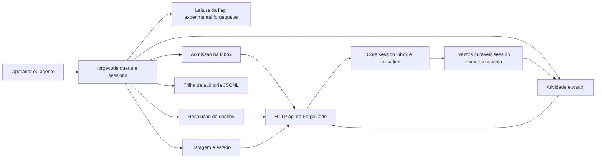

# Design — forgequeue

> Design técnico do change `forgequeue`. Decisões duráveis de arquitetura do produto (fila por
> sessão como primitiva do ForgeCode, e por que não existe barramento global) sobem para ADR em
> `.forge/product/current/adr/` na implementação (TASK-12); aqui ficam referenciadas por `DD-NN`.

## 1. Contexto e restrições

- Monorepo Bun + TypeScript. Direção de dependências (AGENTS.md): `Schema` → `Core`/`Protocol` →
  `Server`; `Client` pode depender de `Schema` e `Protocol`, nunca de `Core`/`Server`; o `CLI`
  depende de `Client` e não importa `Core` (guardado por
  `packages/cli/test/import-boundaries.test.ts`).
- A semântica de fila **já existe no core**: `POST /api/session/:sessionID/prompt` aceita `delivery`
  (`packages/protocol/src/groups/session.ts:337`) e `packages/core/src/session/prompt.ts:52` aplica
  `delivery ?? "steer"`. A inbox é durável, a entrega publica `session.inbox.delivered` e a mensagem
  projetada reusa o id do item (`packages/core/src/session/inbox.ts`, `promotedFromMessage`).
- Ler estado depois do fato não tem replay de evento: `GET /api/event` é stream vivo
  (`packages/server/src/event-feed.ts`). Logo, "entregue" precisa de outra prova: a projeção da
  mensagem com o mesmo id (`GET /api/session/:id/message/:messageID`).
- O CLI já tem um runtime que aceita handler no nó pai **e** subcomandos
  (`packages/cli/src/framework/runtime.ts`, campo `$` de `Handlers` e `provide`), o que permite
  `forgecode queue ...` (enfileirar) e `forgecode queue list|activity` no mesmo nó.
- Flag de capacidade experimental mora em `config.experimental.*` (AGENTS.md, "Experimental API");
  alterar `ConfigExperimental.Info` muda o tipo gerado por `packages/client/script/generate.ts`
  (`ConfigEntry` inlina `Config.Info`, ver `packages/client/src/promise/generated/types.ts:2546`),
  então a regeneração é obrigatória e nunca editada à mão.
- NFRs da change: portabilidade sem shell (NFR-01), enfileiramento não bloqueante (NFR-02), leitura
  limitada (NFR-03), nenhum segredo em artefato (NFR-04).

Normas vigentes consultadas pela superfície tocada:

| Norma | `applies_to` | Situação neste change |
|---|---|---|
| `.forge/rules/architecture/api-and-contracts.md` | backend, frontend | Compatível: sem breaking change; nenhuma rota nova; o campo de config é aditivo e opcional, e o client é regenerado |
| `.forge/rules/conventions/naming.md` | all | Compatível: identificadores em inglês (`queue`, `target`, `delivery`), docs em pt-BR; `queue` não carrega prefixo de tecnologia |
| `.forge/rules/domain/audit-immutability.md` | `services/**`, postgres | Compatível por adaptação: não há tabela; o princípio append-only é honrado abrindo o JSONL em modo `a` e nunca reescrevendo. O mecanismo de REVOKE/trigger não se aplica a arquivo local e isso está declarado, não silenciado |
| `.forge/rules/testing/change-test-contract.md` | all | Compatível: teste de comportamento por módulo; teste de contrato para o campo de config; teste de integração contra servidor real em memória |
| `.forge/rules/testing/quality-gates.md` | all | Compatível: unit para regras de resolução/estado, integração para admissão + entrega |
| `.forge/rules/testing/gate-delivery-channel.md` | all | Compatível: os gates desta change são testes de pacote executados por `bun test` no CI existente; nenhuma config local não versionada é usada para entregá-los |

## 2. Decisão técnica

### 2.1 Visão e componentes



| Componente | Path | Responsabilidade |
|---|---|---|
| `ConfigExperimental` | `packages/schema/src/config/experimental.ts` | campo aditivo `forgequeue` com `enabled` |
| `QueueTarget` | `packages/cli/src/queue/target.ts` | resolver `--thread` / `--to` / `--all`; erro de inexistente, ambíguo e geração anterior |
| `QueueEnqueue` | `packages/cli/src/queue/enqueue.ts` | montar a admissão (texto, delivery, id idempotente), regra de auto-envio, resultado por destino |
| `QueueAudit` | `packages/cli/src/queue/audit.ts` | append-only JSONL com diretório injetável |
| `QueueStatus` | `packages/cli/src/queue/status.ts` | estado derivado por item e união com a inbox viva |
| `QueueActivity` | `packages/cli/src/queue/activity.ts` | snapshot durável e `--watch` sobre SSE |
| `QueueFlag` | `packages/cli/src/queue/flag.ts` | precedência da flag sobre `GET /api/config` |
| `QueueFormat` | `packages/cli/src/queue/format.ts` | render texto e `--json` |
| handlers | `packages/cli/src/commands/handlers/queue.ts`, `.../queue/list.ts`, `.../queue/activity.ts`, `.../sessions.ts` | casca de CLI: flags, saída, códigos de saída |

### 2.2 DD-01 — Reusar `session.prompt` com `delivery`, sem endpoint novo

`--thread/--to/--all` + `--message/--message-file` chamam `client.session.prompt({ sessionID, text,
delivery, id })`. Justificativa: o endpoint já aceita `delivery` e já é idempotente por `id`; criar
`POST /api/session/{id}/queue` duplicaria a admissão, exigiria regeneração do client, teste de
contrato novo e um segundo caminho para o mesmo estado. Consequência: o contrato HTTP de entrada
fica intocado (REQ-15) e o único contrato alterado é o schema de configuração (REQ-14).

**Idempotência obrigatória (REQ-12).** Toda escrita exige `--idempotency-key <k>`; sem ela o parser
recusa (código 2) antes de qualquer chamada. A chave é validada por `^[A-Za-z0-9._-]{1,80}$` e vira
`id = "msg_fq_" + sha256(sessionID + "\n" + k)`, para que a mesma chave em sessões diferentes
não colida no id global. O servidor reconcilia reuso de id de item quando sessão e tipo coincidem
(AGENTS.md, "Session Core"); logo retry com a mesma chave devolve o mesmo item, e o prefixo `msg_fq_`
torna explícito no id que a origem é a fila.

**Auto-envio (REQ-08).** O destino é comparado com `process.env.OPENCODE_SESSION_ID`. Essa variável
é injetada no ambiente de todo comando executado pelo tool de shell
(`packages/core/src/tool/plugin/shell.ts:203`), então a sessão de origem se identifica sem flag
nova; `--allow-self` desarma a regra. Quando a variável não existe (operador humano no terminal),
nada é tratado como auto-envio.

### 2.3 DD-02 — Destino por nome: geração atual = sessões de topo não arquivadas

Algoritmo de `resolveTarget`:

1. `GET /api/session` com `project` do `location.get({ directory: process.cwd() })`, `parentID=null`,
   `archived=false`, `search=<nome>`, `order=desc`, `limit=50`.
2. Filtrar candidatos com `title === <nome>` (o `search` do servidor é `LIKE %nome%`, ver
   `packages/core/src/session/store.ts:155`).
3. Um candidato → resolve. Mais de um → erro `ambiguous` com `id` e `location.directory` de cada um.
   Zero e todas as páginas esgotadas → segunda consulta com `archived=true` + `search=<nome>` para
   distinguir `not found` de `previous generation`; o `id` arquivado **nunca** é usado para
   enfileirar (serve só para a mensagem de erro).
4. Paginação segue `cursor.next` até 10 páginas (o `search` já restringe o conjunto). Atingir o
   limite sem candidato é erro próprio (`too many sessions match`), não `not found` — truncar a
   busca e reportar ausência seria uma afirmação falsa sobre o conjunto.

Justificativa da premissa A1: o ForgeCode não tem registro de geração; o estado durável que
aposenta uma sessão é `archived` (`PATCH /api/session/:sessionID`, `packages/protocol/src/groups/session.ts:300`).
Isso dá as três garantias do PRD §3.5.8 sem inventar armazenamento: só a geração atual resolve,
nome da anterior falha com erro próprio, e nenhum UUID antigo é reutilizado por engano. O Change 3
substitui a fonte do nome por um registro próprio implementando a mesma interface
`(name) => resolved | not-found | ambiguous | previous-generation`, sem mudar o contrato do CLI.

**Broadcast (REQ-09).** `--all` lista todos os candidatos elegíveis (mesma consulta sem `search`),
remove a sessão de origem, valida a lista inteira e só então enfileira em ordem. Resultado por
destinatário é acumulado; qualquer falha torna o código de saída 1, sem rollback das admissões já
feitas (o servidor não expõe transação entre sessões, e desfazer seria uma segunda operação
destrutiva não pedida).

### 2.4 DD-03 — Texto da mensagem

`--message` usa o argumento como está; `--message-file` lê com `Bun.file(path).text()` (UTF-8) e
envia o conteúdo literal — nenhum `eval`, nenhum shell, nenhuma interpolação (REQ-03). Corpo vazio ou
só espaço é recusado antes de qualquer requisição. `--message` e `--message-file` são mutuamente
exclusivos (erro de uso, código 2), assim como `--all` com `--thread`/`--to`.

### 2.5 DD-04 — Estado por item sem replay de evento

`queue list --thread <id>` monta a coleção assim:

1. `GET /api/session/{id}/inbox` → itens pendentes (qualquer origem).
2. Auditoria local filtrada por `sessionID`, mais recente primeiro, até `--limit` (default 100).
3. União por `messageID`; para cada item que **não** está pendente e tem registro de auditoria,
   `GET /api/session/{id}/message/{messageID}`: 200 → `delivered`; 404 → `cancelled`; erro de
   transporte → `unknown`.

`unknown` existe porque "não consegui provar" não é "entregue" — a mesma disciplina de não inventar
aprovação. O limite declarado: itens entregues que nunca passaram por este CLI não aparecem no
histórico (só os pendentes aparecem, vindos da inbox). Isso é uma limitação de observabilidade
documentada, não uma afirmação de cobertura total.

### 2.6 DD-05 — `forgecode sessions`

Comando novo de leitura, sem flag: lista sessões de topo do projeto (`parentID=null`), não
arquivadas por padrão, `--all` inclui arquivadas, segue `cursor.next`. `provider/model` vem de
`Session.Info.model` (`providerID/modelID`), `location` de `location.directory`, `status` derivado:
`archived` se arquivada, `busy` se `time.busy` existe e é maior que `time.idle` (ausente conta como
0), senão `idle`.
`session list` não é alterado (REQ-15); o comando novo existe porque adiciona estado e provedor sem
mudar o contrato de quem já consome o antigo.

### 2.7 DD-06 — Auditoria local append-only

Arquivo `forgequeue/audit.jsonl` sob `Global.Path.data` (`packages/util/src/global.ts` monta o path a
partir de XDG; testes injetam um diretório temporário no módulo, sem `globalThis`). Uma linha JSON
por tentativa:

```json
{"schema_version":1,"timestamp":"2026-11-04T12:00:00.000Z","command":"queue","target":"ORQUESTRADORA","sessionID":"ses_abc","messageID":"msg_fq_dispatch-42","delivery":"queue","idempotencyKey":"dispatch-42","result":"queued","error":null}
```

- Escrita por abertura em modo append (`a`) com `mode: 0o600` na criação (o `umask` ainda pode
  restringir), uma linha por operação; nunca `write` truncando o arquivo.
- `error` truncado em 200 caracteres; o texto da mensagem nunca entra na linha (a fonte durável do
  conteúdo é a inbox, e o texto pode conter segredo — PRD §2.3).
- Leitura é linha a linha, filtrando por `sessionID` e cortando em `--limit` (NFR-03); linha
  corrompida (processo morto no meio da escrita) é ignorada com aviso em stderr, sem abortar a
  listagem.
- Falha de ESCRITA (diretório/arquivo sem permissão) é aviso em stderr e não reverte nem bloqueia o
  resultado da admissão: a trilha é registro local do despacho, e a fonte durável do enfileiramento
  continua sendo `session.inbox.enqueued` (REQ-10).
- Limitação declarada: a trilha é por host/usuário e não cobre enfileiramentos feitos por outro
  cliente; o registro global continua sendo `session.inbox.enqueued`.

### 2.8 DD-07 — Atividade: snapshot durável e `--watch` sem confirmação de leitura

`queue activity --thread <id>`:

- `GET /api/session/{id}` → `time.busy`, `time.idle`, `outcome`; `state` = `busy` se `busy` existe e
  é maior que `idle` (ausente conta como 0), `idle` se `idle` existe e não é superada por `busy`,
  `unknown` se nenhum dos dois existe.
- `GET /api/session/{id}/message?limit=1&order=desc` → `lastMessageAt` (ou `null`).
- `GET /api/session/{id}/inbox` → `pendingCount`.
- `observedAt` é o instante da consulta, para que o leitor saiba a idade do dado.

`--watch` assina `GET /api/event?types=session.inbox.delivered,session.execution.started,session.execution.succeeded,session.execution.failed`,
ignora evento cujo `data.sessionID` não é o alvo, imprime `type` e `created` do primeiro evento da
sessão e sai 0. `--timeout` (default 60000 ms) sem evento → sai 1 com `no activity within <ms>ms`.
Nenhum modo lê texto de mensagem para inferir ociosidade: a regra "ociosidade se mede, não se
presume" (PRD §5.6.5) vira tipo, não prosa.

### 2.9 DD-08 — Erros e códigos de saída

Código 0 = sucesso; 1 = falha operacional (servidor inalcançável, sessão inexistente, nome ambíguo,
geração anterior, flag desligada, falha de admissão, timeout de `--watch`); 2 = erro de uso (flag
inválida, combinação inválida, chave inválida, nenhum destino informado). Mensagens de erro são
constantes de módulo, para que os testes as assertem literalmente sem duplicar lógica. O erro do
cliente HTTP é traduzido por `errorMessage` (`packages/cli/src/util/error.ts`) e a credencial nunca é
interpolada.

### 2.10 DD-09 — Flag `experimental.forgequeue.enabled`

Campo aditivo em `ConfigExperimental.Info`:

```ts
forgequeue: Schema.Struct({ enabled: Schema.Boolean.pipe(optional) }).pipe(optional)
```

Default `false` (ausente = desligado). Leitura no CLI: `GET /api/config` devolve documentos em ordem
de prioridade (menor → maior, `packages/protocol/src/groups/config.ts`); o efetivo é o **último
documento que define a chave** (não o último documento). Só o caminho de escrita (enfileirar,
inclusive `--all`) consulta a flag; `sessions`, `queue list` e `queue activity` continuam
disponíveis desligada, porque são leitura e são o que permite inspecionar a fila antes de habilitar.

### 2.11 DD-10 — CLI: nó pai com handler e subcomandos

`Spec.make("queue", { params: {...}, commands: [list, activity], globalFlags: ServerFlags })` com
handler `$` para o enfileiramento (`Runtime.Handlers` aceita `$?` quando o nó tem filhos). Handlers
são carregados sob demanda em `packages/cli/src/index.ts`, como os demais. `forgecode sessions` é um
nó irmão de `session` no mesmo mapa.

## 3. Alternativas consideradas

| Alternativa | Prós | Contras | Por que não |
|---|---|---|---|
| Endpoint novo `POST /api/session/:id/queue` | contrato explícito de fila; validação no servidor | duplica a admissão, exige regeneração de client, teste de contrato e um segundo caminho para o mesmo estado durável | a rota existente já aceita `delivery`; duplicar aumenta superfície sem ganho (DD-01) |
| Tabela `queue_audit` no servidor | trilha global e consultável por qualquer cliente | migration, retenção, e uma superfície de API fora do escopo declarado no PRD §3.11 | o registro global já é `session.inbox.enqueued`; a trilha pedida é do despacho (DD-06) |
| Registro de nomes próprio (`registry.json` com geração explícita) | nome estável, independente do título | exige comando de registro e um segundo estado para reconciliar; o Change 3 vai trazer o registro dele | inventaria estado que o Change 3 possui, e o PRD não pede comando de bind (DD-02) |
| Inferir "entregue" por `session.inbox.delivered` recebido em `--watch` | sinal direto | só vale para o futuro; não há replay de evento | `queue list` precisa responder sobre o passado (DD-04) |
| Polling com `/api/experimental/session/{id}/wait` para "acordou" | simples | espera ociosidade, não entrega; e a rota é experimental | contradiz "não bloquear" (NFR-02) (DD-07) |
| Flag em `cli.json` (config do CLI) | não depende do servidor | a flag é da capacidade, não da máquina; o Change 3 e o servidor precisam do mesmo valor | `config.experimental.*` é a convenção do projeto (DD-09) |
| `--to` por prefixo/`LIKE` do servidor | menos consultas | resolve o destino errado quando dois títulos compartilham prefixo | a regra do PRD é resolução exata e falha em ambiguidade (DD-02) |

## 4. Contratos e integrações afetados

### 4.1 HTTP consumido (sem mudança)

`POST /api/session/:sessionID/prompt` (`delivery`, `id`, `text`), `GET /api/session`,
`GET /api/session/:sessionID/inbox`, `GET /api/session/:sessionID/message/:messageID`,
`GET /api/event`, `GET /api/config`. Nenhuma rota entra ou sai; `session.prompt` sem `delivery`
continua `steer` (REQ-15).

### 4.2 Configuração (contrato aditivo, versionado pela regeneração)

`ConfigExperimental.Info` ganha `forgequeue?: { enabled?: boolean }`. Compatibilidade: campo
opcional, ausente = desligado; nenhum consumidor existente lê a chave. Como `Config.Info` aparece no
documento OpenAPI, o client gerado muda: `bun run generate` em `packages/client` (nunca editar
`src/promise/generated/*` à mão, AGENTS.md).

### 4.3 Contrato da linha de comando

> Binário: o fork preserva o nome do upstream — a invocação real é `opencode ...`, não `forgecode ...`
> (proposal §4, A7). Os comandos novos `queue` e `sessions` são irmãos de `session` no mapa existente.

- `forgecode queue --thread <uuid> | --to <nome> | --all` com `--message <texto> | --message-file <path>`,
  `--delivery queue|steer` (default `queue`), `--json`, `--idempotency-key <k>` (obrigatório nas
  escritas), `--allow-self`.
- `forgecode queue list --thread <uuid> [--limit N] [--json]`
- `forgecode queue activity --thread <uuid> [--watch] [--timeout MS] [--json]`
- `forgecode sessions [--all] [--json]`
- Saída de sucesso em texto: `Queued message <id> for thread <uuid>` (uma linha por destino em
  `--all`, prefixada pelo destino).
- Códigos de saída: 0/1/2 (DD-08).

### 4.4 Contrato do arquivo de auditoria

JSON Lines, `schema_version: 1`, campos de REQ-10. Mudança futura de forma exige `schema_version`
novo e leitor que aceite as duas versões; o leitor atual ignora linhas com versão desconhecida em
vez de falhar.

### 4.5 Eventos

Nenhum evento novo. `session.inbox.enqueued`, `session.inbox.delivered`, `session.inbox.cancelled` e
`session.execution.*` são apenas consumidos (REQ-06, REQ-11).

## 5. Plano de migração / rollout

Nada a migrar: não há estado prévio nem tabela. O rollout é aditivo e reversível:

1. Schema + regeneração do client (TASK-01, TASK-06), sem efeito em runtime porque a chave de
   configuração é opcional e default `false`.
2. Módulos de fila e handlers atrás da flag desligada por default (TASK-02..TASK-05, TASK-07..TASK-10):
   com a flag ausente, o único comportamento novo observável é o comando existir e recusar a escrita.
3. Documentação e ADR (TASK-12), incluindo a limitação da trilha local e a regra de geração.
4. Habilitação é decisão do usuário: `experimental.forgequeue.enabled: true` em `opencode.json`.
5. Rollback = remover a chave (ou `false`): nenhuma linha de auditoria é lida pelo caminho de
   escrita, nenhum estado do servidor é criado, e as linhas já gravadas permanecem como registro
   histórico append-only.

## 6. Riscos e mitigação

| Risco | Probabilidade | Impacto | Mitigação / detecção |
|---|---|---|---|
| Título de sessão muda e `--to` deixa de resolver | média | médio | `--thread` é o caminho canônico e está documentado primeiro; erro de resolução é explícito (`not found`/`ambiguous`/`previous generation`), nunca silencioso. Detecção: teste de resolução com títulos repetidos e com título arquivado |
| Trilha local não cobre enfileiramento de outro cliente | alta | baixo | `queue list` une a inbox viva; a limitação está no design e no help. Detecção: teste com item pendente sem registro de auditoria |
| `--watch` sem evento por sessão já ociosa confunde o operador | média | baixo | timeout explícito com mensagem própria e código 1; o snapshot responde o passado e o help diz que o watch observa o futuro |
| Handler `$` do nó pai não ser despachado quando há subcomandos | baixa | alto (quebra o contrato de CLI) | teste que executa o CLI real (`Bun.spawn`) para `queue --help` e para uma invocação inválida; se falhar, o plano B é `queue send` como subcomando explícito, decidido antes de TASK-05 fechar |
| Idempotência mascarar uma segunda mensagem legítima com a mesma chave | baixa | médio | a chave é obrigatória e escolhida pelo operador; o id derivado aparece na saída e na auditoria, e o teste assere que duas chaves iguais produzem um item com o mesmo id |
| Auditoria crescer sem limite | média | baixo | `--limit` na leitura (NFR-03); nenhuma rotação automática nesta change (declarado fora de escopo) |
| Segredo vazar em mensagem ou erro | baixa | alto | texto nunca é gravado na trilha; erro truncado e sem header; testes com marcador em REQ-10/REQ-13 |
| Regeneração do client introduzir diff amplo | média | baixo | TASK-06 roda `bun run generate` e verifica que o diff se limita aos tipos de configuração; `bun check` no pacote |

## 7. Rastreabilidade

| REQ | Seção do design que o atende |
|---|---|
| REQ-01 | §2.2, §4.1, §4.3 |
| REQ-02 | §2.3, §4.3, §6 |
| REQ-03 | §2.4 |
| REQ-04 | §2.2, §4.1, §4.3 |
| REQ-05 | §2.4, §2.9, §4.3 |
| REQ-06 | §2.5, §4.1, §4.5 |
| REQ-07 | §2.6, §4.1 |
| REQ-08 | §2.2, §2.3 |
| REQ-09 | §2.3, §4.3 |
| REQ-10 | §2.7, §4.4 |
| REQ-11 | §2.8, §4.5 |
| REQ-12 | §2.2, §4.1 |
| REQ-13 | §2.9, §6 |
| REQ-14 | §2.10, §5 |
| REQ-15 | §2.2, §2.6, §4.1, §5 |
| NFR-01 | §1, §2.4, §6 |
| NFR-02 | §2.2, §2.8 |
| NFR-03 | §2.5, §2.7 |
| NFR-04 | §2.7, §2.9, §6 |
