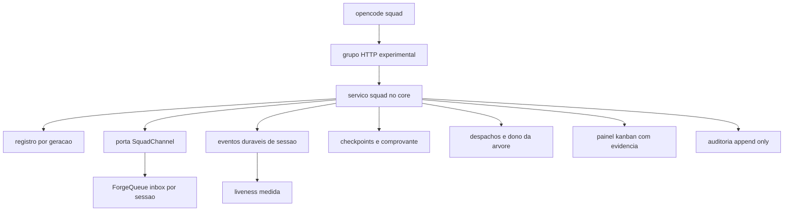

# Design — squad-orchestration

> Design técnico do change `squad-orchestration`. Identificadores de decisão (`DD-NN`) pertencem a este change; citações fora deste arquivo carregam "squad-orchestration".
> Fonte: `proposal.md` + `requirements.md` deste change, PRD `prompts/forgecode-three-changes.md` §5-§6, código do repositório (refs citadas por arquivo:linha) e maquinária de referência em `/Users/milton/Downloads/payments-orquestracao-multisessao/`.

## 1. Contexto e restrições

### 1.1 O que já existe e será reutilizado (não reimplementado)

| Capacidade | Onde está | Como o `squad` usa |
|---|---|---|
| Sessão durável com `model`, `agent`, `location`, `time.busy/idle/updated`, `outcome`, `cost`, `tokens` | `packages/schema/src/session.ts:20-60`; `packages/core/src/session.ts:180-199` | lê `Session.Info` e `Session.log` como evidência; `cost`/`tokens` projetados em REQ-25 |
| Criação de sessão com modelo/variant | `packages/protocol/src/groups/session.ts:160-175` (`session.create`) | `launch` cria com `Model.Ref` (`provider/model#variant`) |
| Fila por sessão com `delivery: queue\|steer` e idempotência por `id` | `packages/protocol/src/groups/session.ts:337-346`; `packages/core/src/session/prompt.ts:24-32`; `packages/core/src/session/inbox.ts:52-57` | porta `SquadChannel` (contrato ForgeQueue) |
| Eventos duráveis de inbox e execução | `packages/schema/src/session-event.ts:214-262` | prova de admissão, entrega e execução; liveness |
| Catálogo de modelos e variants | `packages/core/src/model.ts:77-84` | `check` resolve provider/modelo/variant |
| Git: worktree, diretório comum, branch, HEAD | `packages/core/src/git.ts:15-19,104-170`; `packages/schema/src/vcs.ts:4-12` | dono por árvore (`worktree`/`commonDirectory`), branch medida, base/head |
| Config por bloco com flag e leitura em `nativeAtomic` | `packages/schema/src/config.ts:32-60`; `packages/core/src/config/normalize.ts:210-226`; `packages/core/src/artifact.ts:266-271` | bloco `squad` e `requireEnabled()` |
| Migrations aditivas | `packages/core/src/database/migration/`; `packages/core/src/database/migration.ts` | novas tabelas `squad_*` |
| Convenção de rota experimental | `AGENTS.md` §Experimental API; `packages/protocol/test/experimental-identifiers.test.ts` | grupo `/api/experimental/squad/...` com `experimental.squad.*` |
| HTTP API como contrato gerado | `packages/protocol/src/api.ts`; `packages/client/script/generate.ts` | regenerar client após o grupo novo |

### 1.2 Normas vigentes aplicáveis (varredura pela superfície tocada)

Varredura feita sobre `.forge/rules/**` e `.forge/constitution.md` (baseline `product/current` está vazio: `.forge/product/current/capabilities/` e `.forge/product/current/adr/` sem arquivos), pela superfície que este change cria (CLI, rota HTTP experimental, tabelas novas, teste de segredo, estado durável):

| Norma | Aplicação neste change | Veredito |
|---|---|---|
| `constitution.md` §3 (determinismo onde possível), §7 (segurança por default), §9 (decisões registradas) | validação de estado por schema + índice parcial; segredo recusado na escrita; ADR sugerida em §5.4 | compatível |
| `conventions/machinery-propagation.md` ("estado de projeto mora no tronco, não na branch") | registro/checkpoint em banco de dados do servidor, não em arquivo versionado; export é opt-in fora da árvore | compatível — é a razão da decisão DD-02 |
| `conventions/naming.md` e `constitution.md` §5 (identificadores em inglês, docs em pt-BR) | tipos/campos/rotas em inglês; artefatos e mensagens em pt-BR; sem prefixo de tecnologia | compatível |
| `architecture/security-and-secrets.md`, `conventions/no-hardcoded-secrets.md` | nenhum valor de credencial lido/persistido/logado; varredura de segredo em checkpoint/despacho; redaction na auditoria | compatível |
| `architecture/api-and-contracts.md` (versionamento `/api/v1/`) | o repositório expõe `/api/...` sem versão e `AGENTS.md` fixa `/api/experimental/<group>` como entrada de rota nova; o contrato é gerado do código Effect HttpApi | **divergência de rule registrada**: este change segue o contrato vigente do repositório (ADR de versionamento de API não existe no baseline). Não é conflito bloqueante para o change; é drift da rule, a resolver em change próprio |
| `architecture/observability.md` | logs estruturados sem corpo/caminho; métrica de canal; span HTTP existente | compatível (NFR-06) |
| `testing/gate-delivery-channel.md` e `testing/quality-gates.md` | os testes novos rodam no canal real do CI (`bun run test` por pacote, via `turbo test`); nenhum gate novo é declarado em `runtime.gates` neste change | compatível |
| `testing/regression-red-first.md` | change `type: feature` sem `fixes_defects`; cada TASK declara teste que falha antes e passa depois | compatível |
| `conventions/session-discipline.md` | saída de gate em uma linha; sem resumo por task; comandos com timeout | compatível |
| `conventions/autonomy-yolo.md` | gates HITL deste change são registrados com `--autonomous` apenas por decisão do orquestrador atual; nenhum gate de arquivamento é autoaprovado | compatível |

Nenhuma ADR aceita no baseline cita a superfície (diretório `adr/` vazio em `.forge/product/current/adr/`). Sobreposição com as duas specs dependentes, **medida nos manifests da árvore em 2026-11-04** (`forgequeue` em `tasks-ready`, `subscription-auth` em `proposed`):

| Caminho | `forgequeue` | `subscription-auth` | `squad-orchestration` | Consequência |
|---|---|---|---|---|
| `packages/schema/src/config.ts` | — | sim | sim (bloco `squad` em `Config.Info`) | edição aditiva no mesmo arquivo; rebase após o merge de `subscription-auth` |
| `packages/protocol/src/api.ts` | — | sim | sim (grupo `SquadGroup`) | idem; registro de grupo em linha distinta |
| `packages/server/src/handlers.ts` | — | sim | sim (`SquadHandler`) | idem |
| `packages/cli/src/commands/commands.ts` | sim | sim | sim (grupo `squad`) | idem; três grupos novos no mesmo array |
| `packages/client/src` | sim | sim | sim (gerado) | regenerar depois dos três; nunca editar à mão |
| `packages/cli/test/` | sim (diretório) | arquivos distintos | `squad.test.ts` distinto | sem colisão de arquivo |
| `packages/schema/src/config/experimental.ts` | sim | — | não (bloco `squad` próprio) | sem colisão |
| `packages/core/src/squad/**`, `packages/protocol/src/groups/squad.ts` | — | — | sim | sem colisão |

A sobreposição real é de **arquivos de registro** (aditiva, por linha) e de **contrato** (fila e credencial, §4.5). É hard-stop de merge, não de design: as tasks que editam esses registros (TASK-01, TASK-08, TASK-09) declaram dependência de ordem com os dois changes no PRD §6 e devem ser rebaseadas sobre o estado mergeado deles antes da implementação.

### 1.3 Dependências não congeladas

`forgequeue` e `subscription-auth` estão em especificação paralela (pastas ainda no template em 2026-11-04). Este design projeta contra os contratos do PRD (§3.7 e §4.5) e isola cada um em **um único adapter** (§4.5), de modo que a estabilização dos dois mude um arquivo, não a camada.

Duas precisões de contrato, medidas contra as specs irmãs lidas nesta data:

- **`forgequeue` não publica contrato de servidor.** É um CLI que consome `Session.prompt` com `delivery`/`id` (`forgequeue/design.md` DD-01: "Reusar `session.prompt` com `delivery`, sem endpoint novo"). A porta `SquadChannel` liga **na mesma primitiva do core** (`packages/protocol/src/groups/session.ts:337-346`, `packages/core/src/session/prompt.ts:52`), não num `enqueue` do forgequeue. A dependência declarada no manifest é de **alinhamento de semântica** (queue vs steer, idempotência por `id`, eventos `session.inbox.*`), não de código.
- **`subscription-auth` publica relatório/status, não um método `status(providerID)`.** A superfície é `SubscriptionAuth.Source.report()` (`{present, state, expiresAt, accountLabel}`) e `GET /api/experimental/subscription/status`. O `CredentialPresence` é a projeção `present|absent|unknown` dessa superfície.

### 1.4 Premissas registradas

- **P1 —** o servidor local do ForgeCode é o único processo de confiança; `squad` é serviço de controle dentro dele, não um launcher de terminal (proposal A1).
- **P2 —** "effort" é o `variant` do `Model.Ref` (`provider/model#variant`); o ForgeCode não tem campo de effort separado (proposal A3).
- **P3 —** o ForgeCode não expõe "rollout JSONL"; a evidência de vida é `Session.Info.time` + eventos duráveis de execução/inbox (proposal A4).
- **P4 —** uma geração por vez é `active`; o índice parcial único no banco é a garantia, não a checagem de aplicação (DD-01).
- **P5 —** o painel existente continua sendo o consumidor de `kanban.json`; o `squad` produz o documento, não serve UI (REQ-17).
- **P6 —** "execução produtiva travada" em `activate` é metadado auditável (`productive: false`); o ForgeCode não possui gate de direitos de execução e este design não inventa um (REQ-16).
- **P7 —** o `squad` não cria worktree nem diretório: `Location` e branch existem antes do `check`; criação de árvore é do operador/Forge, e `check` reprova o que não existe em vez de criar (REQ-04).

## 2. Decisão técnica

### 2.1 Visão geral (DD-01)

O `squad` é um **serviço de controle** no core, exposto por um grupo HTTP experimental e consumido pelo CLI. Nada de script de launcher, nada de iTerm, nada de barramento paralelo.



**DD-01 — Serviço de core + grupo HTTP experimental + CLI, com persistência relacional.**
- Módulos: `packages/schema/src/squad.ts` (tipos), `packages/schema/src/config/squad.ts` (config), `packages/core/src/squad/{index,sql,store,registry,evidence,channel,credential,checkpoint,dispatch,ownership,transition,panel,audit,event}.ts`, `packages/protocol/src/groups/squad.ts`, `packages/server/src/handlers/squad.ts`, `packages/cli/src/commands/squad.ts`, `packages/cli/src/commands/handlers/squad.ts`.
- O grupo HTTP é **global** (não recebe o middleware de `Location`): o registro atravessa `Location`s por definição (sessões em worktrees e repositórios distintos). Cada operação que toca uma sessão resolve a `Location` pelo registro e usa `LocationServiceMap.get(session.location)` só quando precisa de serviço `Location`-scoped, respeitando a regra de Session Core do `AGENTS.md`.
- O CLI fala com o servidor pelo client gerado; não há caminho que rode a lógica em processo separado do servidor.

**Alternativa descartada:** package `packages/squad` separado consumindo só a API pública. Descartada porque o registro/checkpoint/transição exigem transação e consistência com o banco do servidor; um pacote cliente não teria como garantir atomicidade nem o índice único de geração ativa (ver §3).

### 2.2 Modelo de dados (DD-02)

**DD-02 — Estado operacional em tabelas próprias no banco do servidor, com auditoria append-only.**
Justificativa: `conventions/machinery-propagation.md` proíbe estado durável de projeto nascer na branch (todo worktree veria uma cópia divergente). Registro e checkpoint são estado de execução; o banco já é o store durável do servidor (`packages/core/src/database/database.ts`) e dá transação, WAL e recuperação.

Tabelas (migration aditiva, uma nova migration em `packages/core/src/database/migration/`):

| Tabela | Colunas principais | Invariantes |
|---|---|---|
| `squad_generation` | `id` (text pk), `run_id` (text unique), `state` (`active\|closed`), `config_digest`, `created_at`, `closed_at`, `source_generation_id` | índice único parcial `(state) where state='active'` ⇒ no máximo uma geração ativa |
| `squad_session` | `generation_id`, `name`, `role`, `provider`, `model`, `variant`, `location`, `branch`, `session_id`, `adopted_at`, `state` (`creating\|starting\|verified\|closed\|failed`), `marker`, `prompt_sha256`, `checkpoint_sha256`, `productive` (0/1), `last_error`, `created_at`, `updated_at` | pk `(generation_id, name)`; unique parcial `(generation_id, session_id) where session_id is not null` |
| `squad_tree_owner` | `id` (text pk), `tree_key`, `tree_scope` (`worktree\|repository`), `generation_id`, `owner_name`, `since`, `released_at`, `acquired_via` (`launch\|dispatch`) | unique parcial **global** `(tree_key) where released_at is null` ⇒ um dono ativo por árvore em toda geração; `generation_id` é atributo, não parte da chave |
| `squad_checkpoint` | `generation_id`, `name`, `sha256`, `body`, `bytes`, `created_at` | pk `(generation_id, name, sha256)`; histórico preservado (append) — `squad_session.checkpoint_sha256` aponta o mais recente; `bytes` limitado por `squad.checkpoint.max_bytes` (default `1 MiB`) |
| `squad_transition` | `source_generation_id` (pk), `target_generation_id`, `source_registry_digest`, `previous_sessions_closed`, `previous_orchestrator_kept_open`, `created_at` | só existe após `close` completo |
| `squad_transition_entry` | `source_generation_id`, `name`, `session_id`, `checkpoint_sha256`, `closed_at` | pk `(source_generation_id, name)`; espelha o conjunto do registro de origem |
| `squad_dispatch` | `id` (text pk), `generation_id`, `orq_id`, `seq`, `scope`, `owner`, `base`, `head`, `base_oid`, `head_oid`, `validation` (`verified\|unknown\|failed`), `dor`, `dod`, `proof`, `exclusions` (json), `exigidos` (json, default `["ci","merge","acceptance"]`), `milestone`, `state` (`open\|accepted\|done\|blocked`), `accepted_at`, `accepted_by`, `created_at` | unique `(generation_id, orq_id)` e `(generation_id, seq)`; sequência alocada na mesma transação; `accepted` produzido só por `dispatch accept` |
| `squad_audit` | `id` (integer pk autoincrement), `at`, `kind`, `generation_id`, `target`, `session_id`, `message_id`, `delivery`, `result`, `idempotency_key`, `actor`, `prev_hash`, `detail` | sem API de update/delete; `detail` já redigido na escrita; `prev_hash` = sha256 da linha anterior (cadeia auditável) |
| `squad_idempotency` | `key` (pk), `generation_id`, `kind`, `result_ref`, `created_at` | resposta repetida devolve `result_ref` |
| `squad_block` | `generation_id`, `name`, `waiting_on` (`human\|tool`), `reason`, `author`, `created_at`, `cleared_at` | pk `(generation_id, name)`; `cleared_at` nulo = bloqueio ativo; alimenta o `cause` do liveness |

Convenções de schema seguem `AGENTS.md` §Schema Definitions (Drizzle, snake_case, sem nome de coluna explícito).

**Reserva de identificador.** Nomes novos (`squad_generation`, `squad_session`, `squad_tree_owner`, `squad_checkpoint`, `squad_transition`, `squad_dispatch`, `squad_audit`, `squad_block`, `squad_idempotency`, `squad_orchestration`, `experimental.squad`) foram varridos em `git log --all -S<nome>` em 2026-11-04, com controle positivo no mesmo instrumento (`-Ssquad` → 2 commits; `-Ssession_inbox` → 14): os nomes devolvem 0 ocorrências. Nenhuma tabela, rota ou conceito homônimo existe no histórico.

### 2.3 Registro, resolução e digest canônico (DD-03)

**DD-03 — Nomeração e endereçamento.** `generation.id` é slug do operador (ex.: `gen-2026-11-04`) validado por `^[a-z0-9][a-z0-9-]*$`; `run_id` é UUID v4 gerado no `init`. `name` é o papel em maiúsculas, único por geração. A resolução por nome consulta **somente** `squad_session where generation_id = (select id from squad_generation where state='active')`; UUID (`ses_...`) consulta por `session_id` em qualquer geração e devolve também a geração a que pertence.

**DD-04 — Digest canônico do registro.** Função única `registryDigest(generation)`:

1. Projeta cada sessão para exatamente `{name, provider, model, variant, location, branch, sessionID, state}` (campos ausentes viram `null`).
2. Ordena por `name` por **code point** (`a < b ? -1 : a > b ? 1 : 0`), nunca `localeCompare`.
3. Serializa com `JSON.stringify` (sem espaços, sem newline final) sobre o objeto `{generation, sessions}` com as chaves nessa ordem.
4. `sha256` dos bytes UTF-8 em hex minúsculo.

Exemplo computado (fixture de teste):

```json
{"generation":"gen-2026-11-04","sessions":[{"name":"ATLAS","provider":"kimi","model":"k3.1-pro","variant":"high","location":"/w/atlas","branch":"feature/y","sessionID":"ses_2","state":"verified"},{"name":"ORQUESTRADORA","provider":"deepseek","model":"deepseek-flash","variant":"high","location":"/w/orq","branch":"feature/x","sessionID":"ses_1","state":"verified"}]}
```

`sha256` UTF-8 desse JSON = `786d7eb4896706ae559887f05468829c12e45eed0763e4cb3ea3bef925e01498` (verificado com `node:crypto` em 2026-11-04). O teste de fixture falha se a projeção, a ordenação ou a serialização mudarem.

**Idempotência de mutação.** Operações de ciclo de vida (`init`, `launch` por sessão, `close`, `transition`, `activate`) têm chave derivada determinística (`sha256(kind + "\n" + generation + "\n" + alvo)`), porque repetir a operação é retry e não nova intenção. `send` e `broadcast` só são idempotentes com `--idempotency-key` explícita: sem chave, duas mensagens de texto igual são duas mensagens (dedupe por conteúdo engoliria um "continue" repetido). Toda chave é consultada em `squad_idempotency` na mesma transação e devolve o `result_ref` gravado quando já existe com o mesmo `kind`/geração; chave reusada com conteúdo diferente é `ConflictError`.

**`--replace` (DD-03a).** Sem geração `active` anterior, `--replace` equivale a `init` normal. Com geração `active` anterior, `--replace` exige `--reason` e aplica **o mesmo predicado de `close`** (§2.6): todas as sessões com checkpoint íntegro, nenhuma execução ativa fora da sessão que emite o comando e `inbox_pending` zerado. Satisfeito, marca a anterior `closed` (sem `squad_transition` — não há comprovante de transição) e cria a nova `active` na mesma transação; insatisfeito, `ConflictError` e a anterior permanece `active`. A anterior fechada por `--replace` grava `closed_by: "replace"` e continua alcançável por `session_id`.

### 2.4 Canal (DD-05)

**DD-05 — `SquadChannel` é a única porta de mensagem; a implementação usa a primitiva de inbox que o ForgeQueue expõe.**

```ts
// packages/core/src/squad/channel.ts
interface Channel {
  enqueue(input: {
    sessionID: Session.ID
    text: string
    delivery: "queue" | "steer"
    idempotencyKey: string
    metadata?: Record<string, unknown>
  }): Effect.Effect<{ messageID: SessionMessage.ID }, ChannelError>
  pending(sessionID: Session.ID): Effect.Effect<ReadonlyArray<{ id: SessionMessage.ID; delivery: "queue" | "steer"; createdAt: number }>>
}
```

- `messageID` é derivado da chave quando ela existe: `"msg_" + sha256(idempotencyKey + "\n" + sessionID).slice(0, 24)`; sem chave explícita, usa `SessionMessage.ID.create()`. Como `session.prompt` aceita `id` (`packages/protocol/src/groups/session.ts:339`) e a admissão de `id` repetido é idempotente por `AGENTS.md` §Session Core, repetir a entrega com a mesma chave não duplica linha de inbox. O marcador de bootstrap usa a chave interna `bootstrap:<generation>:<name>`.
- O retorno do comando é **prova de enfileiramento** (id + aceite), nunca de leitura; a prova de que a outra ponta acordou é `session.inbox.delivered`/`session.execution.started`, exposta por `status`/`liveness` (REQ-13), não pelo `send`.
- Default de `delivery` é `queue` (mensagem de orquestração não interrompe passo em curso); `steer` é opt-in.
- `SquadChannel` não resolve nome (resolução é do registro, DD-03) e não decide liveness.
- `pending(sessionID)` é **consumido** por `status` (`inbox_pending`, REQ-07) e por `close` (recusa quando há `enqueued` sem `delivered`, salvo `--force --reason`, REQ-11) — não é uma superfície órfã.

### 2.5 Launch e verificação por evidência (DD-06)

**DD-06 — `launch` é uma máquina de estados write-ahead; `verified` exige quatro evidências duráveis.**

Estado de cada sessão (transições persistidas com timestamp; nenhuma transição regride sem `--retry`):

```
creating ──create session──> starting ──4 evidências──> verified
    │                            │
    └──────────── falha ─────────┴──> failed ──--retry──> creating
verified ──close──> closed
```

1. `creating`: grava `marker = "SQUAD-<generation>-<name>"`, `prompt_sha256` do bootstrap renderizado e `state`. Nenhum efeito externo antes disso.
2. Cria (ou adota) a sessão com `model` e `agent`; grava `session_id`, `message_id` derivado e `state = starting`. A ordem é: persistir `starting` **antes** de admitir o prompt, para que uma queda não permita segunda admissão com id diferente.
3. Verificação, lendo `Session.Info` e `Session.log({sessionID, after: 0})` (`packages/core/src/session.ts:183-199`):
   - `model`: `Session.Info.model` = `provider/model#variant` esperado (prova de provider, modelo e effort);
   - `enqueued`: evento `session.inbox.enqueued` com `inboxID = message_id`;
   - `delivered`: evento `session.inbox.delivered` com o mesmo `inboxID`;
   - `execution`: evento `session.execution.started` **posterior à admissão do marcador** (mesmo agregado, `seq` maior que o de `enqueued`).
4. Timeout (default `90 seconds`, config `squad.launch.verify_timeout`) mantém `starting`, grava `last_error` com a evidência ausente e retorna erro; nunca apaga sessão nem registro. De `starting` (após timeout ou evidência ausente) o `--retry` é aceito com `--reason`, **sem exigir passar por `failed`**; quando o problema é provider/modelo/variant, `squad session replace` (REQ-23) é a saída, não `--retry` cego.
5. Adoção (`--adopt name=ses_...`) grava `adopted_at` e verifica a sessão existente com as mesmas evidências, exigindo `session.execution.started` posterior a `adopted_at`; `enqueued`/`delivered` só são exigidas quando o marcador foi admitido pelo `squad` (registro guarda `message_id` nesse caso). Execução antiga à adoção não promove a `verified`.
6. **Aquisição de posse** (DD-10): ao concluir a verificação, se a sessão tem `Location`/`tree_key` e ainda não existe linha de posse ativa para aquela árvore, `launch` grava a primeira linha em `squad_tree_owner` (`acquired_via: launch`); o primeiro `dispatch` para a árvore confirma (`acquired_via: dispatch`, se o `launch` não a adquiriu). Sem essa aquisição, o `dispatch`/`send --dispatch` não teria como recusar takeover.

A criação de sessão não "abre aba": o cliente que se conectar ao servidor enxerga a sessão. É a tradução de P1/P3 para o comportamento observável. `launch --only <name>` processa um nome e falha se ele não pertence à geração ativa; o restante da geração não é tocado.

### 2.6 Checkpoint, fechamento, transição e ativação (DD-07)

**DD-07 — Checkpoint é corpo validado + hash; fechamento é comprovante; transição é amarração por digest; ativação é entrega de transferência.**

- **Checkpoint** (`squad checkpoint`): seções obrigatórias por título exato `Resultado`, `Fontes`, `Comandos e provas`, `Limites`, `Próximos passos`, `Posse da árvore`, cada uma com corpo não vazio. Corpo é normalizado (UTF-8, `\r\n` → `\n`, BOM removido); `sha256` sobre os bytes normalizados. Varredura de segredo de alta confiança (PEM, `Bearer`, `sk-`, `ghp_`, `AKIA`, `"token": "..."`) recusa por default, com `--allow-secret-like-text --reason <texto>` registrado na auditoria. A coluna `squad_session.checkpoint_sha256` recebe o hash do checkpoint mais recente. A exportação em arquivo (`--export-dir`) é feita pelo CLI depois da resposta, fora da árvore versionada — o servidor não escreve em caminho arbitrário.
- **Close** (`squad close --generation <id>`): recusa se (a) alguma sessão da geração não tem checkpoint ou o `sha256` gravado difere do recálculo sobre o corpo persistido; (b) alguma sessão tem execução ativa, medido por `SessionExecution.isActive` verdadeiro **ou** `time.busy` posterior a `time.idle` sem `outcome` terminal; (c) a geração não é `active`; (d) existe item `enqueued` sem `delivered` correspondente (`inbox_pending > 0`) para qualquer sessão da geração, salvo `--force --reason <texto>` (auditado). Claim preservado por shutdown é exatamente o caso (b) e não é auto-liberado: a reconciliação é retomar a sessão ou interrompê-la explicitamente, e `interrupt` com motivo `user` libera o claim (`packages/core/src/session/execution.ts:126-134`). **A sessão que emite o `close`** (default: a orquestradora mantida aberta; `--by <name|session_id>` explicita outra) é **excluída do predicado (b)** — dela exige-se apenas checkpoint íntegro — porque durante o comando ela está inevitavelmente `busy`. Escreve `squad_transition` + `squad_transition_entry` em uma transação, marca `state = closed` e grava `closed_by` no comprovante e na auditoria. A sessão cujo papel é orquestradora é registrada como mantida aberta (`previous_orchestrator_kept_open: true`) e não é encerrada pelo `squad`; geração sem papel de orquestradora grava `false`.
- **Transition** (`squad transition --from <g>`): exige `squad_transition` existente para `<g>`, conjunto de entradas exatamente igual ao registro de origem, `source_registry_digest` igual ao digest atual do registro de origem, e `target_generation_id` nulo ou igual à geração ativa. Grava o vínculo (`target_generation_id`). Repetir com o mesmo alvo é no-op; alvo diferente é `ConflictError`. A geração nova já é a única `active` desde o `init` dela; a anterior está `closed`; a transição só **prova** e amarra.
- **Activate** (`squad activate`): exige todas as sessões `verified` + transição vinculada; entrega a mensagem de transferência pela `SquadChannel` com chave `activate:<generation>`; grava auditoria e mantém `productive = 0`.

Ordem operacional: `close (anterior) → init (nova) → transition --from (anterior) → launch (nova) → activate (nova)`. O `close` vem primeiro porque o índice parcial só admite uma geração `active`; a validação não depende da ordem de `launch`/`activate`, só da completude e dos hashes. `transition` sem geração ativa falha com mensagem acionável (não cria geração).

### 2.7 Liveness (DD-08)

**DD-08 — Liveness é derivada; a fórmula é única e o limiar é configurável.**

```
working       : execução em curso — claim preservado (SessionExecution.isActive verdadeiro OU claim de shutdown não liberado) OU (time.busy != null && (time.idle == null || time.busy > time.idle)) sem outcome terminal
idle          : !working && (now - lastActivity) <= staleAfter
stalled       : !working && (now - lastActivity) >  staleAfter
presumed_dead : working && (busySince < now - deadAfter)   // busySince = time.busy OU início do claim
unknown       : nenhuma atividade durável (sem time.idle e sem evento de execução/inbox)
lastActivity  = max(time.idle, último terminal de execução, última entrega de inbox)   // admissão (enqueued) NÃO entra
sentAt        = última admissão de inbox (campo informativo, não entra em lastActivity)
cause         = squad_block.reason + waiting_on (human|tool) quando bloqueio ativo; "claim ausente" quando presumed_dead
```

- `staleAfter` vem de `squad.liveness.stale_after` (default `60 minutes`) e `deadAfter` de `squad.liveness.dead_after` (default `24 hours`), ambos validados na carga (`Effect.DurationFromString` + `> 0` + `deadAfter > staleAfter`); valor inválido reprova a config.
- O veredito carrega `measuredAt`, `lastActivity`, `sentAt`, `source` (`execution|inbox`), `sessionState`, `working_stale` (booleano), `presumed_dead` (booleano) e `cause` (string|nulo).
- `working_stale = working && busySince < now − staleAfter`: `working` prova execução em curso, não progresso — uma sessão bloqueada à espera de aprovação de permissão/ferramenta mantém `time.busy` e não cresce `lastActivity`. O sinal é derivado de evidência durável (`time.busy`), nunca de texto de agente, e não reclassifica o veredito primário.
- **Segundo limiar** `presumed_dead`: `working` cujo `busySince` é anterior a `now − deadAfter` escala `working_stale` para `presumed_dead` — uma sessão cujo processo morreu mas cujo claim foi preservado **não lê `working` para sempre**. A resposta é sinalizar para reconciliação/interrupção explícita, **sem auto-liberar o claim** (o claim é a mesma evidência que o `close` consulta em §2.6).
- `squad block --waiting human|tool --reason <texto>` (REQ-24) grava `squad_block`; o `cause` distingue "espera de aprovação humana", "ferramenta travada" e "processo morto" — em vez de conflacionar as três num único `working_stale`.
- Fonte: `Session.Info.time` + `Session.log` filtrando `session.execution.*` e `session.inbox.*` + o claim de execução (`SessionExecution.isActive`/claim de shutdown) + `squad_block`. Renomear, mudar título ou metadata atualiza `time.updated` e **não** conta como atividade — `time.updated` não entra no cálculo, e a admissão de inbox (`enqueued`) também não (admitir mensagem para um processo morto não o ressuscita). Nenhum campo de título, metadata ou mensagem participa; o teste de REQ-13 cobre o caso "agente diz que está viva".
- Exemplo computado (REQ-13): `stale_after=60m`, `lastActivity=10:00` ⇒ `10:59` = `idle`, `11:01` = `stalled`; sem atividade ⇒ `unknown`; `working` com `busySince` anterior a `now − dead_after` ⇒ `presumed_dead`.
- O default `60 minutes` difere das "duas horas" do referencial (README "lições") **por decisão registrada**: `stale_after` é configurável e o relógio durável (`time.busy`/`time.idle`) é evidência mais forte que `mtime` de rollout. O default `24 hours` de `dead_after` é novo neste change (não existe no referencial) e é configurável.

### 2.8 Protocolo de despacho e dono da árvore (DD-09, DD-10)

**DD-09 — Despacho é schema fechado, id alocado na transação, base/head medidos quando possível.**

Campos obrigatórios e validação: `orq_id` (gerado, `ORQ-<generation>-<NNN>`), `scope`, `owner` (nome na geração ativa), `base`, `head`, `dor`, `dod`, `proof`, `exclusions` (lista não vazia), `exigidos` (subconjunto não vazio de `{jira, ci, merge, deploy, acceptance}`, default `[ci, merge, acceptance]`), `milestone`. A validação coleta **todos** os campos faltantes antes de falhar (uma resposta, não N respostas). `seq` é `max(seq)+1` dentro da transação que insere o despacho, com `unique(generation_id, seq)` como backstop.

- `base`: `Git.history.resolve(repository, base)` (novo método, `rev-parse --verify --quiet`). Existente ⇒ grava `base_oid`, `validation=verified`; ausente ⇒ reprova.
- `head`: sintaxe validada por regra documentada e determinística (`^(?!-)(?!.*\.\.)(?!.*@\{)(?!/)(?!.*//)(?!.*/$)(?!.*\.lock$)[A-Za-z0-9._/-]+$`), sem depender de git; existente ⇒ grava `head_oid`; ausente mas válido ⇒ `validation=unknown` com motivo.
- Sem git (`Git.repo.discover` vazio): ambos `unknown`, despacho aceito com aviso explícito.
- O despacho pode ser entregue na mesma chamada (`--send`), reusando a `SquadChannel` com chave `dispatch:<orq_id>`; a mensagem renderiza os campos do despacho.
- **Aceite** (`squad dispatch accept --orq <orq_id>`, rota `POST /api/experimental/squad/dispatch/:orqId/accept`): só aceita despacho da geração ativa em estado `open`; grava `state = accepted`, `accepted_at`, `accepted_by` e auditoria (`kind: dispatch_accept`). Repetir é no-op idempotente; `done`/`blocked` ou outra geração é `ConflictError`. É o **único** produtor de `squad_dispatch.state = accepted`, que alimenta o estágio `acceptance` do painel (§2.9).

**DD-10 — Dono por árvore é chave derivada do git, com escopo configurável.**

- `tree_key` = `Git.Repository.worktree` com `squad.writer_scope: "worktree"` (default) e `Git.Repository.commonDirectory` com `"repository"`. Sem git, `tree_key` = `Location` canônico (`realpath`), e `tree_scope = worktree`.
- Um dono ativo por `tree_key` via índice parcial **global** (`unique (tree_key) where released_at is null`), com `generation_id` como atributo — a posse não é escopada por geração: uma árvore tem no máximo um dono ativo em toda geração, e a geração nova não pode adquirir enquanto a anterior não liberar. `dispatch` e `send --dispatch` recusam alvo diferente do dono ativo. `release --from --to --reason` exige checkpoint do dono atual cujo `sha256` confere com o persistido, grava auditoria e fecha a linha de posse (`released_at`), abrindo a nova na mesma transação.
- **Aquisição explícita** (DD-10a): a primeira linha de posse é criada no `launch` (na verificação, quando a sessão tem `tree_key`), com `acquired_via: launch`; o primeiro `dispatch` para a árvore **confirma** (`acquired_via: dispatch`, se o `launch` não a adquiriu). Sem essa aquisição, não haveria linha de posse para o `dispatch`/`send --dispatch` recusar takeover — a coluna `owner_name` só existia na tabela, nenhum caminho a criava.
- `send` sem despacho não é bloqueado por posse: mensagem não é atribuição de escrita.

### 2.9 Painel e evidência por estágio (DD-11)

**DD-11 — `kanban.json` compatível com o consumidor existente, com estágio só quando há evidência.**

Documento: `{versao_schema: 1, revisao, atualizado_em, colunas: ["backlog","in_progress","in_review","blocked","done"], cards: {id: {...}}, fonte: {...}}` — mesmas chaves lidas por `priorizacao/build_kanban.py:202-217`. `versao_schema: 1` fixa **cinco colunas** como o esquema deste change; a separação entre "merge" e "deploy" que o referencial fazia como colunas é expressa aqui nos **estágios** `estagios.merge`/`estagios.deploy` (não em colunas), mantendo compatibilidade com o consumidor que lê `colunas` fixas.

Card: campos de compatibilidade (`id`, `titulo`, `coluna`, `agente`, `prioridade`, `prs`, `refs`, `evidencias`, `bloqueio`, `atualizado_em`) + extensão aditiva `estagios` e `desconhecido[]` e `progressa` (boolean).

Fonte de cada estágio:

| Estágio | Fonte | `verified` quando |
|---|---|---|
| `jira` | adapter de comando configurado (`squad.panel.jira_command`) que emite JSON somente leitura | o item existe e o snapshot tem `updated` posterior ao despacho |
| `ci` | arquivo `squad.panel.ci_evidence` ou adapter de comando | existe check com `conclusion=success` **pelo nome** que prova a afirmação, no mesmo `head_oid` |
| `merge` | git local: `git merge-base --is-ancestor <head_oid> <base>` (via `Git`) | ancestralidade verdadeira |
| `deploy` | arquivo/adaptador de evidência de deploy | artefato com digest/ref igual ao `head_oid` |
| `acceptance` | registro de aceite do despacho (`squad_dispatch.state = accepted`, produzido por `dispatch accept`) | aceite explícito do dono com `head_oid` conferido |

- `unknown` quando a fonte não está configurada, o comando falha, o arquivo não existe ou o dado não cobre o ref do card. `failed` quando a fonte responde negativamente (check vermelho, não ancestral, deploy de outro digest).
- `exigidos[]` por card (subconjunto dos cinco; default `[ci, merge, acceptance]`, gravado na coluna `squad_dispatch.exigidos`). Estágio fora de `exigidos[]` sem fonte continua `unknown` e aparece em `desconhecido[]`, mas não impede `done`; estágio exigido sem evidência impede.
- `coluna`: `done` sse todo estágio em `exigidos[]` é `verified`; `in_review` quando `merge` está `verified` e `acceptance` não; `in_progress` quando existe despacho aceito/em execução e `merge` não; `blocked` quando algum estágio exigido é `failed` ou o despacho está marcado bloqueado; `backlog` caso contrário.
- `progressa = false` sempre que `desconhecido[]` não é vazio (inclui estágio não exigido sem fonte); o painel existente não deve desenhar barra nesse caso (campo novo, aditivo).
- Adapters nunca escrevem: Jira só leitura, git só leitura, CI só leitura. Nenhuma credencial é lida pelo `squad`; o `evidence` guarda apenas `status`, referência e instante — nunca stdout bruto do adapter — e o texto que porventura entre em `detail` passa pela redaction de REQ-18.
- **Execução de comando no servidor (documentado, não implícito):** `squad.panel.jira_command`/`squad.panel.ci_command` são **comandos executados pelo processo do servidor** (não pelo cliente), somente leitura, com timeout e sem shell de interpolação (argumentos passados como array, `execFile`), e a saída é reduzida a `status`/referência/instante — nunca `stdout` bruto nem o caminho absoluto do operador. Configurar um comando arbitrário equivale a delegar execução ao servidor; o default é **não ter** comando configurado (estágio `unknown`).
- Superfície: `panel build`/`panel show` no CLI; o documento é consumido pelo plugin `painel-kanban` externo (P5) — não há tela de TUI/app própria neste change. `panel show` resume por coluna (contagem por coluna, cards com `progressa: false`, cards em `desconhecido[]`), e `build --out` grava o documento.

### 2.10 Flag, configuração e erros (DD-12)

**DD-12 — Flag única, default desligado, erro tipado por reuso do contrato existente.**

Bloco de configuração (novo `packages/schema/src/config/squad.ts`, agregado em `packages/schema/src/config.ts` e listado em `nativeAtomic` de `normalize.ts`):

```ts
{
  enabled: boolean            // default false
  state_dir?: string          // default <Global.Path.data>/squad; base default de --export-dir/--out
  liveness: { stale_after: duration, dead_after: duration }   // defaults "60 minutes" / "24 hours"
  writer_scope: "worktree" | "repository"    // default worktree
  launch: { verify_timeout: duration }        // default "90 seconds"
  checkpoint: { max_bytes: number }           // default 1048576 (1 MiB)
  credential: { expiry_warn: duration }       // default "7 days"
  panel: { jira_command?: string, ci_command?: string, ci_evidence?: string }
}
```

- Não existe `channel.delivery` de config: o `delivery` é decisão **por comando** (`--delivery queue|steer`, default `queue`), não estado global — a porta `SquadChannel` fixa o default e aceita override na chamada. Config exposta e nunca consumida foi removida (LOW do parecer).
- `state_dir` é consumido como base default dos caminhos de export (`checkpoint --export-dir`, `audit export --out`) quando a flag não informa caminho completo.

- Leitura do flag: `Config.latest(entries, "squad")?.enabled === true` + `requireEnabled()` que falha com `Squad.DisabledError` (tagged error do core), mapeado no handler para `ForbiddenError` (403) com a mensagem `squad.enabled is false. Set squad.enabled in config to use squad.` — mesmo padrão de `packages/core/src/artifact.ts:86,266-271`.
- Erros de domínio reusam o contrato existente, sem classe nova em `packages/protocol/src/errors.ts`: `ConflictError` (409) para estado/transição/posse/idempotência conflitante; `InvalidRequestError` (400) para schema/validação; `ForbiddenError` (403) para flag desligada e self-send; `SessionNotFoundError` (404) para `session_id` inexistente; `ServiceUnavailableError` (503) para canal/servidor indisponível.
- A superfície CLI traduz o erro tipado para mensagem acionável e código de saída `1`, com `--json` emitindo `{error: {code, message, details}}`.

### 2.11 Build, geração de contrato e testes

- Protocol mudou ⇒ `bun run generate` em `packages/client` (não editar gerado à mão).
- Suítes: `packages/core/test/squad/*.test.ts` (domínio + store com banco temporário), `packages/protocol/test/squad.test.ts` (rota e identificador), `packages/server/test/squad.test.ts` (handler com `ServerFetch` + client), `packages/cli/test/squad.test.ts` (help, parse de flags, erros de flag desligada) e `packages/schema/test/squad.test.ts` (schemas e digest? — o digest é core; schema testa codecs).
- Fixtures reaproveitam `Config.testLayer(entries)` + `Global.layerWith({data})` + `AppNodeBuilder.build` (`packages/core/test/artifact.test.ts:39-60`) e `tmpdirScoped` (`packages/core/test/fixture/tmpdir.ts`); rede externa é recusada por `refuseNetwork` (`packages/core/test/lib/effect.ts`).
- Nenhum gate novo em `runtime.gates`: os testes rodam no canal real do CI por pacote (`bun run test` → `turbo test --concurrency=3`), então a prova de canal é o próprio job de teste.

### 2.12 Check (DD-13)

**DD-13 — `squad check` valida configuração, catálogo e `Location` sem criar sessão nem ler segredo.**

- Por sessão, emite veredito `ok|warn|fail` com motivo para cada checagem: **configuração** (campos obrigatórios presentes e tipados), **provider/modelo/variant** (`Model.get` + `Info.variants`, `packages/core/src/model.ts:77-84`), **`Location`** (diretório existe e é repositório git), **branch** (`Vcs.Info.branch`, `packages/schema/src/vcs.ts`; branch medida ≠ esperada ⇒ `fail`; não medível ⇒ `warn`/`unknown`) e **presença de credencial** (`present|absent|unknown` via `CredentialPresence`, §4.5).
- Modelo/variant inexistente ⇒ `fail` nomeando provider/modelo/variant e a lista de variants disponíveis. Presença de credencial nunca expõe valor; com a flag de `subscription-auth` desligada, cai para presença de provider configurado, nunca leitura de token.
- `check` é **somente leitura**: não cria sessão, não enfileira, não altera registro e não grava auditoria de mutação; repetir produz o mesmo relatório (exceto timestamps). `--json` emite documento consumível sem parsing de texto.
- Modelo mental: `check` é a porta que o operador usa **antes** de `init`/`launch`; `plan` (§2.13) é a simulação dos efeitos; `launch` (§2.5) é o efeito real. Os três não compartilham efeito colateral.

### 2.13 Plan (DD-14)

**DD-14 — `squad plan` renderiza o que `launch` faria, sem efeito.**

- Por sessão, na ordem da configuração, renderiza: `provider`, `modelo`, `variant`, `Location`, `branch` esperada, `session_id` existente (marca `adotar`) ou `"novo"` (marca `criar`), e o `sha256` do prompt de bootstrap. Não cria sessão, não enfileira, não escreve registro nem auditoria.
- Após `plan`, o digest canônico do registro (DD-04) é idêntico ao de antes, a contagem de sessões do servidor é idêntica e não existe linha de auditoria nova — `plan` é pura projeção do `launch` sobre o estado atual.
- `plan` não falha com flag ligada e zero sessões; falha com a mensagem de REQ-01 quando a flag está desligada. `--json` emite o documento.

### 2.14 Broadcast (DD-15)

**DD-15 — `squad broadcast` valida todos antes do primeiro enfileiramento e reporta falha parcial, best-effort.**

- Resolve **todos** os destinatários e valida cada um (estado `verified`, não é a origem) **antes** de enfileirar o primeiro; se qualquer destinatário for inválido, **nenhum** enfileiramento acontece e o relatório lista todos os inválidos.
- Com todos válidos, entrega por `SquadChannel` na ordem da configuração; o resultado por destinatário é `accepted`, `rejected` ou `not_attempted`. A entrega é **best-effort não-transacional**: a inbox do core não faz rollback — se um enfileiramento falhar no meio, os já enfileirados **permanecem** e o restante é `not_attempted` com o motivo; o comando encerra diferente de zero se ao menos um não foi aceito. A origem nunca é incluída, salvo `--include-self`.
- Reusa a `SquadChannel` e a idempotência por `--idempotency-key` de REQ-08; auditoria por destinatário na ordem da configuração.

## 3. Alternativas consideradas

| Alternativa | Prós | Contras | Por que não |
|---|---|---|---|
| A. Script/CLI standalone que orquestra via API pública (espelhar `squad.py`) | entrega rápida, sem migration, isolada do core | sem transação entre registro e efeito; estado no filesystem do usuário; concorrência de dois comandos corrompe registro; não há índice único de geração ativa | não cumpre REQ-02/REQ-11 (atomicidade e comprovante) nem `conventions/machinery-propagation.md` |
| B. Persistir registro/checkpoint em arquivos versionados no repositório (`.forge/squad/*.json`) | diff auditável, leitura simples, igual ao referencial | estado de execução na branch: todo worktree diverge, merge colide por construção; escrita concorrente sem lock | viola a rule de propagação de estado; descartada com a mesma justificativa |
| C. Estado como eventos duráveis do Bus com projeção (event sourcing completo) | replay e auditoria nativos | novo agregado com projector, replay e migration de eventos só para bookkeeping operacional; custo desproporcional ao valor | estado não precisa de replay; reconciliação por transação + `squad_idempotency` cobre o requisito de idempotência |
| D. Novo pacote `packages/squad` consumindo só HTTP | isolamento de dependências, build menor | não garante atomicidade nem índice único; duplica regra de validação fora do servidor; duas verdades | o registro precisa ser validado onde os dados vivem |
| E. `launch` shell-out para o CLI `queue`/provider (como o referencial) | reuso do CLI existente | acopla servidor a processo externo, sem idempotência transacional, impossível provar admissão | viola P1 e REQ-19 (integração por contrato) |
| F. Liveness por `mtime` de arquivo de rollout | simples, igual ao referencial | o ForgeCode não tem rollout JSONL; mtime de arquivo qualquer é forjável e não cobre execução em banco | P3: usar eventos duráveis + `Session.Info.time` é mais forte e real |
| G. Dono da árvore por repositório sempre (regra literal) | simples, uma chave só | proíbe paralelismo legítimo em worktrees do mesmo repositório, que é o fluxo do ForgeCode | escopo configurável (DD-10) preserva a regra e o fluxo; default documentado |

## 4. Contratos e integrações afetados

### 4.1 Grupo HTTP experimental `squad`

Todas as rotas ficam sob `/api/experimental/squad/...` com identificador `experimental.squad.<method>` (exigência de `packages/protocol/test/experimental-identifiers.test.ts` e de `AGENTS.md` §Experimental API). O grupo é global (sem middleware de `Location`); o middleware de `Authorization` do servidor continua valendo.

| Método e rota | Identificador | Payload → resposta | Erros |
|---|---|---|---|
| `POST /api/experimental/squad/generation` | `experimental.squad.generation.create` | `{generation, sessions[], replace?, idempotencyKey?}` → `{data: Generation}` | 400, 403, 409 |
| `GET /api/experimental/squad/generation` | `experimental.squad.generation.get` | — → `{data: {active, previous}}` | 403 |
| `POST /api/experimental/squad/generation/:generationID/close` | `experimental.squad.generation.close` | `{idempotencyKey?}` → `{data: TransitionReceipt}` | 400, 403, 404, 409 |
| `POST /api/experimental/squad/transition` | `experimental.squad.transition` | `{from, idempotencyKey?}` → `{data: TransitionReceipt}` | 400, 403, 409 |
| `GET /api/experimental/squad/session` | `experimental.squad.session.list` | — → `{data: {generation, sessions[]}}` | 403 |
| `POST /api/experimental/squad/session/:sessionRef/launch` | `experimental.squad.session.launch` | `{retry?, adopt?, timeout?}` → `{data: SessionEntry}` | 400, 403, 404, 409, 503 |
| `POST /api/experimental/squad/session/:sessionRef/send` | `experimental.squad.session.send` | `{text, delivery?, dispatch?, allowSelf?, idempotencyKey?}` → `{data: EnqueueProof}` | 400, 403, 404, 409, 503 |
| `POST /api/experimental/squad/session/:sessionRef/replace` | `experimental.squad.session.replace` | `{provider, model?, variant?}` → `{data: SessionEntry}` | 400, 403, 404, 409, 503 |
| `POST /api/experimental/squad/broadcast` | `experimental.squad.broadcast` | `{text, includeSelf?, idempotencyKey?}` → `{data: {results[]}}` | 400, 403, 409, 503 |
| `POST /api/experimental/squad/checkpoint` | `experimental.squad.checkpoint` | `{name, body, allowSecretLikeText?, reason?}` → `{data: Checkpoint}` | 400, 403, 404, 409 |
| `POST /api/experimental/squad/dispatch` | `experimental.squad.dispatch.create` | `DispatchInput` → `{data: Dispatch}` | 400, 403, 409 |
| `GET /api/experimental/squad/dispatch` | `experimental.squad.dispatch.list` | — → `{data: Dispatch[]}` | 403 |
| `POST /api/experimental/squad/dispatch/:orqId/accept` | `experimental.squad.dispatch.accept` | — → `{data: Dispatch}` | 400, 403, 404, 409 |
| `POST /api/experimental/squad/block` | `experimental.squad.block` | `{name, waitingOn, reason, clear?}` → `{data: Block}` | 400, 403, 404, 409 |
| `POST /api/experimental/squad/release` | `experimental.squad.release` | `{from, to, reason}` → `{data: TreeOwner}` | 400, 403, 404, 409 |
| `POST /api/experimental/squad/activate` | `experimental.squad.activate` | `{idempotencyKey?}` → `{data: EnqueueProof}` | 403, 409, 503 |
| `GET /api/experimental/squad/panel` | `experimental.squad.panel` | — → `{data: PanelDocument}` | 403 |
| `GET /api/experimental/squad/liveness` | `experimental.squad.liveness` | — → `{data: LivenessReport}` | 403 |
| `GET /api/experimental/squad/audit` | `experimental.squad.audit` | `{kind?, limit?}` → `{data: AuditEntry[]}` | 400, 403 |
| `GET /api/experimental/squad/check` | `experimental.squad.check` | — → `{data: CheckReport}` | 403 |
| `GET /api/experimental/squad/plan` | `experimental.squad.plan` | — → `{data: PlanDocument}` | 403 |

Compatibilidade: **aditivo**. Nenhuma rota existente muda; nenhum payload existente ganha campo obrigatório; o client regenerado só acrescenta `experimental.squad.*`. Como toda rota é experimental, renomear/remover não exige alias (AGENTS.md); a única estabilização prevista é a promoção futura para rota estável, registrada em `CHANGELOG.md` quando acontecer.

### 4.2 Schemas públicos (`packages/schema/src/squad.ts`)

`Squad.Generation`, `Squad.SessionName` (string validada), `Squad.SessionRef` (nome **ou** `Session.ID`), `Squad.SessionEntry`, `Squad.SessionState`, `Squad.DispatchInput`, `Squad.Dispatch`, `Squad.Checkpoint`, `Squad.TransitionReceipt`, `Squad.Liveness` (com `presumed_dead`, `cause`, `sent_at`), `Squad.Block`, `Squad.CostSnapshot`, `Squad.PanelDocument`, `Squad.AuditEntry` (com `actor`, `prev_hash`), `Squad.EnqueueProof`, `Squad.CheckReport`, `Squad.PlanDocument`. Todos com `annotate({identifier})` estável e `Schema.Class`/`Struct` no padrão do repositório (sem `any`).

### 4.3 CLI

`opencode squad <subcomando>` (o nome do binário vem de `OPENCODE_CLI_NAME`, `packages/cli/src/commands/commands.ts:30,49`; o PRD chama de `forgecode`). Subcomandos e flags estão na tabela de superfície de `requirements.md`; `--json` existe em `check`, `plan`, `status`, `launch`, `send`, `broadcast`, `close`, `transition`, `dispatch list`, `panel build`. Subcomandos novos deste parecer: `dispatch accept --orq <orq_id>`, `session replace --name <X> --provider <p> [--model <m>] [--variant <v>]`, `block --name <X> --waiting human|tool --reason <r> [--clear]`, `audit export --since <iso> --out <path>` (devolve o digest da cadeia).

### 4.4 Banco e migration

Uma migration aditiva cria as dez tabelas e os índices parciais de §2.2. Nenhuma tabela existente é alterada. O bootstrap aplica a migration via `DatabaseMigration.apply` (`packages/core/src/database/database.ts:44-49`), sem backfill: tabela nova nasce vazia e a primeira geração é criada por `squad init`.

### 4.5 Portas de dependência (contratos não congelados)

| Porta | Promessa consumida | Promessa do outro lado | Se o contrato mudar |
|---|---|---|---|
| `SquadChannel` (inbox do core) | `enqueue(sessionID, text, delivery, idempotencyKey) → messageID`; `pending(sessionID)`; eventos `session.inbox.enqueued`/`delivered` | `Session.prompt(sessionID, text, delivery, id)` — admissão idempotente por `id` (AGENTS.md Session Core); entrega publica `session.inbox.delivered`; não há ack de leitura. É a primitiva pré-existente do core, a **mesma** que o CLI do `forgequeue` consome — não um contrato publicado pelo `forgequeue` | só `channel.ts` muda; teste de contrato em `packages/core/test/squad/channel.test.ts` com servidor falso |
| `CredentialPresence` (SubscriptionAuth) | `status(providerID) → {presence: present\|absent\|unknown, expiresAt?, expiryWarn: bool}` | `SubscriptionAuth.Source.report()` (`{present, state, expiresAt, accountLabel}`) ou `GET /api/experimental/subscription/status`; presença/validade sem valor; nunca lança por ausência; flag desligada ⇒ `unknown`; `expiresAt` vira **aviso** (`expiryWarn`) quando expira em até `squad.credential.expiry_warn`, sem mudar o veredito primário | só `credential.ts` muda; `check` continua com fallback `unknown` |
| Resolução de modelo | `Model.get(providerID, modelID)` e `variants` | catálogo do ForgeCode | nenhum acoplamento a `subscription-auth` |

O que **depende** do contrato estabilizado deles: (a) a semântica de `delivery` e a idempotência de admissão (REQ-08/REQ-09); (b) a decisão `present|absent|unknown` de `check` (REQ-04). O que **não** depende: registro, digest, checkpoint, transição, despacho, dono de árvore, painel, custo/cota e liveness — todos locais. O custo/cota (REQ-25) lê `Session.Info.cost`/`tokens` e o evento `session.usage.recorded` (locais do core), **não** a superfície do `subscription-auth`; só o `expiresAt`/`expiryWarn` passa por `CredentialPresence`. O `SquadChannel` não invoca o CLI do `forgequeue` (que é processo `client`, inalcançável a partir do `core`), nem depende de o `forgequeue` existir: a primitiva de inbox já está no `core` hoje.

## 5. Plano de migração / rollout

1. **Flag e schema primeiro:** `squad.enabled: false` por default; o deploy não muda comportamento de ninguém. Verificação: REQ-01/REQ-21.
2. **Migration aditiva** aplicada no bootstrap; tabelas vazias não são lidas por nenhum caminho existente.
3. **Protocolo + client:** grupo experimental entra, `bun run generate`, teste de identificadores experimentais verde.
4. **CLI atrás da flag:** subcomandos existem sempre; sem flag, falham com mensagem acionável (não somem do help — o help é como o operador descobre a flag).
5. **Ativação de uso:** operador liga a flag, roda `check`/`plan` (sem efeito), depois `init`/`launch`.
6. **Rollback:** desligar a flag interrompe toda operação; o estado permanece nas tabelas (não é apagado). Desinstalar a camada exigiria migration de drop, fora deste change.
7. **ADR (obrigatória antes da implementação):** decisão durável e transversal — "camada de orquestração multi-sessão como serviço de controle do servidor, com estado operacional em banco e canal pela inbox" — deve ser registrada via `/forge:adr new` (`.forge/product/current/adr/` existe vazio; numeração atribuída na execução). Este design não duplica o conteúdo; referencia a decisão. É a **TASK-00** (Wave 0), da qual **todas as waves dependem** — a ADR precede qualquer código.
8. **Documentação:** doc do pacote de CLI + `squad --help` + script de demonstração sem credencial (REQ-20). A demonstração consome o feed de eventos já existente do servidor (`packages/server/src/event-feed.ts`) para mostrar `session.inbox.delivered` — não cria canal de observação novo.

## 6. Riscos e mitigação

| Risco | Probabilidade | Impacto | Mitigação / detecção |
|---|---|---|---|
| R1 — contrato do ForgeQueue muda (semântica de `delivery`, idempotência, evento) | média | alto | porta única + teste de contrato com servidor falso; falha isola em `channel.ts` (REQ-19) |
| R2 — contrato do SubscriptionAuth muda (status de presença) | média | médio | porta única + fallback `unknown`; `check` nunca falha por ausência de contrato (REQ-04) |
| R3 — `verified` fraco: sessão admite prompt mas não executa | média | alto | quatro evidências obrigatórias + teste que falha com sessão sem `execution.started` (REQ-06) |
| R4 — duplicação de sessão em retomada de `launch` | baixa | alto | write-ahead + `session_id` persistido antes da admissão + teste de queda entre passos (REQ-06) |
| R5 — digest canônico divergente (ordem/serialização) | baixa | alto | função única + exemplo computado fixo na fixture; `localeCompare` proibido (REQ-11) |
| R6 — falso positivo de segredo bloqueia checkpoint legítimo | média | médio | `--allow-secret-like-text --reason` auditado + teste com texto legítimo contendo `token=` em prosa (REQ-10) |
| R7 — painel mostra estágio sem evidência | média | alto | `progressa=false` obrigatório com `desconhecido[]` + teste que falha se `done` com estágio exigido não verificado (REQ-17) |
| R8 — dois comandos concorrentes corrompem registro | baixa | alto | transação + índices únicos parciais + `squad_idempotency`; teste concorrente (REQ-02) |
| R9 — regressão em `queue`/`auth`/inbox | baixa | alto | suíte de regressão (TASK-31) + flag desligada por default (REQ-21) |
| R10 — vazamento de caminho absoluto em log/erro | média | médio | log só com `generation`/`name`; erro de auditoria sem caminho; teste de NFR-02 |
| R11 — dono de árvore com escopo errado bloqueia trabalho legítimo | média | médio | `writer_scope` configurável + mensagem de erro com o comando de liberação (REQ-15) |

## 7. Rastreabilidade

| REQ | Seção do design que o atende | `spec-delta` |
|---|---|---|
| REQ-01 | §2.10 (DD-12), §1.1 | REQ-SQUAD-001 |
| REQ-02 | §2.2 (DD-02), §2.3 (DD-03/DD-03a), §4.4 | REQ-SQUAD-002 |
| REQ-03 | §2.3 (DD-03), §4.1 (`:sessionRef`) | REQ-SQUAD-003 |
| REQ-04 | §2.12 (DD-13), §4.5, §1.1 | REQ-SQUAD-004 |
| REQ-05 | §2.13 (DD-14), §2.3 | REQ-SQUAD-005 |
| REQ-06 | §2.5 (DD-06), §4.1 | REQ-SQUAD-006 |
| REQ-07 | §2.7 (DD-08), §2.4 (pending), §4.1 | REQ-SQUAD-007 |
| REQ-08 | §2.4 (DD-05), §4.5 | REQ-SQUAD-008 |
| REQ-09 | §2.14 (DD-15) | REQ-SQUAD-009 |
| REQ-10 | §2.6 (DD-07), §2.2 | REQ-SQUAD-010 |
| REQ-11 | §2.6 (DD-07), §2.3 (DD-04), §2.7 (claim) | REQ-SQUAD-011 |
| REQ-12 | §2.6 (DD-07), §2.3 (DD-04) | REQ-SQUAD-012 |
| REQ-13 | §2.7 (DD-08) | REQ-SQUAD-013 |
| REQ-14 | §2.8 (DD-09), §1.1 (Git) | REQ-SQUAD-014 |
| REQ-15 | §2.8 (DD-10/DD-10a) | REQ-SQUAD-015 |
| REQ-16 | §2.6 (DD-07), §1.4 (P6) | REQ-SQUAD-016 |
| REQ-17 | §2.9 (DD-11) | REQ-SQUAD-017 |
| REQ-18 | §2.2 (DD-02), §2.6, §2.10, §4.3 (audit export) | REQ-SQUAD-018 |
| REQ-19 | §4.5 | REQ-SQUAD-019 |
| REQ-20 | §5 (itens 4, 8), §4.3 | REQ-SQUAD-020 |
| REQ-21 | §5 (itens 1-6), §4.1 (compatibilidade) | REQ-SQUAD-021 |
| REQ-22 | §2.8 (DD-09 aceite), §2.9 (acceptance) | REQ-SQUAD-022 |
| REQ-23 | §2.5 (DD-06 replace) | REQ-SQUAD-023 |
| REQ-24 | §2.7 (DD-08 cause), §2.2 (`squad_block`) | REQ-SQUAD-024 |
| REQ-25 | §2.7, §4.5 (CredentialPresence), §1.1 | REQ-SQUAD-025 |

NFRs: NFR-01 → §2.7/§2.11; NFR-02 → §2.6/§2.9/§2.10; NFR-03 → §1.4 (P1)/§2.11; NFR-04 → §2.3 (idempotência)/§2.2; NFR-05 → §2.1/§2.8/§2.11; NFR-06 → §2.10/§4.1.
