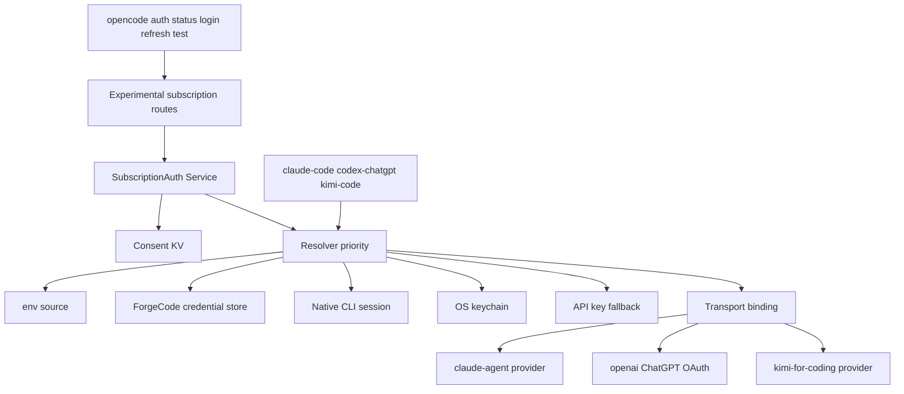

# Design — subscription-auth

> Design técnico do change `subscription-auth`. Decisões duráveis e transversais merecem ADR (`/forge:new-adr`) — a decisão de produto fica registrada em `specs/v2/subscription-auth.md` (TASK-23), no formato dos documentos existentes em `specs/v2/`.

## 1. Contexto e restrições

### 1.1 O que já existe e é reutilizado

| Peça existente | Onde | Como o change usa |
|---|---|---|
| Métodos de integração (`key`, `env`, `external`, `oauth`, `command`) e store de credenciais com conta ativa | `packages/schema/src/integration.ts:20-70`, `packages/core/src/integration.ts:120-260`, `packages/core/src/credential.ts` | Fonte `store`; `login`/`logout`/`switch` continuam usando os mesmos endpoints |
| `Credential.External` como referência a segredo gerenciado fora do store | `packages/schema/src/credential.ts:44-52` | Modelo existente para referência externa; este change **não** o usa para sessão nativa (DD-01/DD-07), só o tipo `Credential.Value` como material |
| Renovação OAuth com janela de 5 min, timeout 30 s e lock por credencial | `packages/core/src/integration.ts:699-730` (`connection.resolve`) | Caminho de `auth refresh` para credencial gerenciada |
| Provider `claude-agent` (roda o `claude` do usuário; não lê login salvo) | `packages/core/src/plugin/provider/claude-agent/index.ts`, `specs/v2/claude-agent-provider.md` | Transporte do adapter `claude-code` |
| Login ChatGPT com escopo de token sharing | `packages/core/src/plugin/provider/chatgpt.ts:170-180` | Transporte `managed` do adapter `codex-chatgpt` |
| Device flow OAuth | `packages/core/src/plugin/provider/xai.ts:44-74`, `packages/core/src/integration.ts:430-470` | Padrão de UI/estado para o login delegado do Kimi |
| Host mapping `kimi-for-coding` → protocolos `moonshot` | `packages/core/src/aisdk-native.ts:107` | Provider do adapter `kimi-code` |
| Endpoint Anthropic-compatible do Kimi (`/coding/v1`) | `packages/ai/src/protocols/anthropic-messages.ts:736`, `packages/ai/test/provider/anthropic-messages.test.ts:1115` | Base URL do binding Kimi |
| Catálogo `kimi-code-plan-global` (modelos `k3`, `k3.1-pro`, `kimi-*`) | `packages/core/src/models-dev/snapshot.txt` (entrada `kimi-code-plan-global`, doc `https://www.kimi.ai/code/docs/en/kimi-code/models.html`) | Catálogo de modelos do binding Kimi |
| Rotas experimentais + teste de identificadores | `packages/protocol/src/groups/integration.ts:46-60`, `packages/protocol/test/experimental-identifiers.test.ts` | Forma das rotas novas |
| Serviços internos e ordem de plugins | `packages/core/src/plugin/internal.ts:120-236` (services) e `240-301` (pre/post) | Registro do serviço e do plugin host |
| CLI `auth` existente | `packages/cli/src/commands/commands.ts:165-237`, `packages/cli/src/commands/handlers/auth/*` | Extensão aditiva |

### 1.2 Normas vigentes aplicadas (varredura pela superfície tocada)

- `specs/v2/claude-agent-provider.md` (“Login”): o opencode **nunca** lê o login salvo do Claude Code e **nunca** fica entre Claude Code e Anthropic. Compatível: o adapter `claude-code` só detecta presença/validade e delega login; o token nunca entra no processo. Um design alternativo (Keychain OAuth + `anthropic-beta`) é incompatível e foi descartado em §3.
- `specs/v2/provider-policy.md` (“Applying Provider Policy”): política `provider.use` roda depois das transformações de catálogo. Compatível: o provider de assinatura é apenas mais um provider; a filtragem por política continua no plugin de policy (`packages/core/src/config/plugin/policy.ts`).
- `AGENTS.md` (Convenções): dependências `Schema → Core/Protocol → Server`; `Client` pode depender de `Schema`/`Protocol`, nunca de `Core`/`Server`. Compatível: tipos novos nascem em `packages/schema`, o serviço em `packages/core`, as rotas em `packages/protocol`, os handlers em `packages/server`. O CLI fala HTTP, não importa `core`.
- `AGENTS.md` (Experimental API): rota nova começa em `/api/experimental/<grupo>`, identificador `experimental.<grupo>.<método>`, SDK em `client.experimental.<grupo>.*`, `bun run generate` em `packages/client`. Compatível.
- `packages/schema/src/config.ts` (self-export pattern em `src/config`): o módulo novo `config/subscription-auth.ts` é exportado por `ConfigSubscriptionAuth` e embutido em `Config.Info` como `subscription_auth`.
- `.forge/rules/architecture/security-and-secrets.md` e `.forge/rules/conventions/no-hardcoded-secrets.md`: nenhum segredo em código/config/log. Compatível por construção (DD-07, DD-08); a prova é o teste de sentinela e `check-secrets.sh` (TASK-24).
- `.forge/rules/testing/change-test-contract.md`: mock só em fronteira não controlada (Keychain, CLI, HTTP do provider). Compatível: sessão nativa é testada com HOME/diretórios reais temporários; Keychain e CLI são fronteiras substituídas.
- `.forge/rules/conventions/naming.md`: identificadores em inglês, sem prefixo de tecnologia. Compatível (`SubscriptionAuth.Source`, `SubscriptionAuth.Resolver`, provider `kimi-for-coding`).
- ADRs: `.forge/product/current/adr/` contém apenas `.gitkeep` (vazio, `ls -la` nesta sessão) e o repositório não tem `docs/adr/`; não há ADR aceita citando esta superfície. **Sobreposição de paths com as specs irmãs ativas (medida nesta sessão contra os manifests reais, não presumida):** `forgequeue` e `squad-orchestration` estão em `tasks-ready` com `affected_paths` **preenchidos**, e há sobreposição **aditiva** com este change nos arquivos de registro compartilhados — `packages/schema/src/config.ts` (squad), `packages/protocol/src/api.ts` (squad), `packages/server/src/handlers.ts` (squad), `packages/cli/src/commands/commands.ts` (forgequeue + squad) e `packages/cli/src/index.ts` (forgequeue), além de `packages/client` (os três). A sobreposição é de **tocar o mesmo arquivo de registro de forma aditiva** (novo bloco de config, novo grupo de rota, novo subcomando), não de dependência de spec: cada change adiciona seus próprios símbolos e a reconciliação de merge é mecânica (sem hard-stop), mas exige atenção de merge em `config.ts`, `api.ts`, `handlers.ts`, `commands.ts` e no client regenerado. Nenhuma das três altera o mesmo símbolo existente.

### 1.3 Reserva de identificador (com controle positivo)

```text
$ git log --all -S'subscription_auth' --oneline            # vazio
$ git log --all -S'SubscriptionAuth' --oneline             # vazio
$ git log --all -S'subscription.auth.changed' --oneline    # vazio
$ git log --all -S'credential.updated' --oneline | head -2 # controle: c6056f3931, 1434464f7e
$ grep -rn "CredentialResolver" packages                    # vazio
```

Colisão encontrada e tratada: o identificador `CredentialSource` **já existe** como tipo AWS em `packages/ai/src/protocols/utils/bedrock-auth.ts:20`. Por isso os exports são `SubscriptionAuth.Source` e `SubscriptionAuth.Resolver` (DD-02), e o requisito correspondente registra a divergência de nome em relação ao PRD.

## 2. Decisão técnica

### 2.1 Componentes

```text
packages/schema/src/subscription-auth.ts          tipos de fonte, relatório, resolução, erro, evento
packages/schema/src/config/subscription-auth.ts   config subscription_auth (flag, ordem, fallback, aviso)
packages/core/src/subscription.ts                 namespace público (export * as SubscriptionAuth)
packages/core/src/subscription/source.ts          contrato Source + relatório
packages/core/src/subscription/resolver.ts        serviço Resolver (prioridade, cache, fallback)
packages/core/src/subscription/native-session.ts  leitores de sessão (claude, codex, kimi) + keychain
packages/core/src/subscription/redaction.ts       redação e mapeamento de erro
packages/core/src/subscription/notice.ts          texto/versão do aviso de ToS
packages/core/src/subscription/consent.ts         aceite em KV por provider e versão
packages/core/src/subscription/adapters/*.ts      claude-code, codex-chatgpt, kimi-code
packages/core/src/subscription/plugin.ts          plugin host (registro, evento, binding)
packages/core/src/plugin/provider/kimi.ts         provider kimi-for-coding (probe + catálogo)
packages/protocol/src/groups/subscription.ts      5 rotas experimentais
packages/server/src/handlers/subscription.ts      handlers
packages/cli/src/commands/handlers/auth/*.ts      status, refresh, test; login/logout estendidos
```

O fluxo de leitura é único: CLI → HTTP → serviço `SubscriptionAuth` → `Resolver` → fontes do adapter → relatório/resolução. O fluxo de uso é o inverso do store: o provider vinculado pede a resolução ao serviço (ou recebe o resultado já aplicado pelo plugin host) e constrói o cliente com o material resolvido.



### 2.2 Decisões (DD)

**DD-01 — Camada de resolução sobre o substrato existente, não um store paralelo.**
`SubscriptionAuth` não grava credencial própria: usa `Credential` para o que é gerenciado (OAuth/key) e lê a sessão nativa do CLI como fonte somente-leitura, **sem criar credencial nem conexão** para ela. Alternativa (referência `Credential.External` por sessão) foi considerada e descartada: `Provider.snapshot` marca um provider disponível pela presença de conexão (`packages/core/src/provider.ts:489-505`), então uma conexão apontando para sessão não transferível (Codex) ou para arquivo que pode desaparecer deixaria o provider visível e falhando na primeira requisição. Consequência: `auth switch/export/import` continuam funcionando sem alteração e `auth logout` nunca tem o que remover de uma sessão nativa (REQ-09).

**DD-02 — Nomes `SubscriptionAuth.Source` e `SubscriptionAuth.Resolver`.**
`CredentialSource` colide com o tipo AWS em `packages/ai/src/protocols/utils/bedrock-auth.ts:20`; `CredentialResolver` está livre, mas o par deve ser simétrico e buscável. O contrato do PRD (§4.4) é preservado em semântica; a diferença é de nome e está registrada em REQ-02.

**DD-03 — Prioridade fixa `env → store → native → keychain → api_key`, com override declarativo.**
Justificativa: intenção explícita do usuário primeiro (env específica, depois o que ele conectou no ForgeCode), depois a sessão que a máquina já tem, depois o cofre do SO, e a API key como último recurso oficial. Override por `subscription_auth.sources.<provider>` existe para o caso de duas sessões na mesma máquina, e é validado contra os `kind` declarados pelo adapter (REQ-03). Fonte expirada não aborta a cadeia: vira `state: "expired"` + `skipped`.

**DD-04 — Claude: transporte é o provider existente, token nunca é lido.**
O adapter detecta por **presença** (`$CLAUDE_CONFIG_DIR/.credentials.json`, chave `oauthAccount`, item de Keychain via `security find-generic-password -s …` sem `-w`) sem abrir o arquivo de credenciais, e delega `claude auth login --claudeai`; o provider `claude-agent` continua sendo quem executa o Claude e conhece a validade real. Isso cumpre `specs/v2/claude-agent-provider.md` (“never reads Claude Code's saved login”) e elimina a maior superfície de risco de ToS/vazamento. `expiresAt` de Claude é `null`/`unknown` por decisão, não por falha. `auth test claude-code` roda a sondagem do `claude-agent` (o mesmo probe de status do plugin, `packages/core/src/plugin/provider/claude-agent/claude/probe.ts`).

**DD-05 — Codex: sessão nativa é declarada, não transferida.**
O OAuth ChatGPT do ForgeCode exige o escopo `chatgpt.tokens.use.direct` e rejeita tokens sem ele (`packages/core/src/plugin/provider/chatgpt.ts:170-180`); a sessão do `codex login` não tem esse escopo. Transferi-la exigiria falar com o endpoint privado do Codex CLI, o que o PRD §4.11 e a postura de ToS proíbem. Logo: `--source managed` é o caminho de inferência; `--source native` apenas garante/inspeciona a sessão do CLI e reporta `usable_by_forgecode: false`, sem criar conexão — `Provider.snapshot` marca um provider disponível pela presença de conexão (`packages/core/src/provider.ts:489-505`), e uma conexão `openai` apontando para token não transferível deixaria o provider visível e falhando na primeira requisição. `auth test codex-chatgpt` usa o transporte gerenciado, nunca o token nativo.

**DD-06 — Kimi: provider `kimi-for-coding` sobre `moonshot` messages + Bearer.**
`aisdk-native.ts:107` já mapeia o id `kimi-for-coding` para os protocolos `moonshot`, que usam `bearerRouteDefaults` (`packages/ai/src/providers/moonshot.ts:103`), e a URL `https://api.kimi.com/coding/v1` é a reconhecida pelo protocolo (`anthropic-messages.ts:736`, fixture em `anthropic-messages.test.ts:1115`). O plugin adiciona o provider com `settings.baseURL` e modelos do catálogo `kimi-code-plan-global` com `cost` zerado (assinatura). **O token nunca entra em `settings` nem em `headers` do provider**, porque `/api/provider` devolve os dois (`packages/server/src/handlers/provider.ts` e `Provider.Info`): o `authorization: Bearer` é injetado por requisição no hook `model.request`, cujos headers substituem os da rota (`packages/core/src/session/model-request.ts:337-359`), lendo a sessão com cache em memória e revalidando perto da expiração. A premissa “o token do `kimi login` é aceito nesse endpoint” é validada por uma sondagem que o login de assinatura executa antes de reportar sucesso (REQ-06/REQ-11); falha mantém o provider fora do catálogo e devolve `transport_unavailable`, nunca um modelo quebrado no seletor.
Renovação: `kimi` renova a sessão sozinho; o ForgeCode relê o arquivo na troca de credencial (`ProviderRefresh.onSwitch`) e, em 401, revalida uma vez e recarrega o provider; persistindo, `session_expired` com o comando oficial.
Injeção do Bearer: o `model.request` hook injeta `Authorization: Bearer` a partir do **material resolvido pelo serviço** — o token da sessão nativa OU o `Credential.Key` do fallback (`KIMI_API_KEY`, REQ-13). O fallback **não** depende do `bearerRouteDefaults` do `moonshot` (`packages/ai/src/providers/moonshot.ts:103`, que lê `MOONSHOT_API_KEY`/`MOONSHOTAI_API_KEY`, não `KIMI_API_KEY`): o valor é passado explicitamente pela resolução, nunca lido por env do protocolo. Isso fecha a lacuna de fiação do REQ-13 (a chave do fallback não seria lida pelo protocolo default).

**DD-07 — Token nativo nunca é persistido.**
Nenhuma escrita acontece por causa de uma sessão nativa: o material é lido no momento do uso, com cache em memória por janela de validade, e `auth export` (que exporta o store) não tem o que vazar. Consequência aceita: reinício do servidor relê o arquivo (barato), o provider de assinatura é recalculado na ativação/`reload`, e a sessão continua sendo do CLI, não do ForgeCode.

**DD-08 — Redação central e códigos fechados.**
`SubscriptionAuth.Redaction` mascara cabeçalhos e campos sensíveis e trunca corpo de erro de provider (200 caracteres), e `SubscriptionAuth.Error` é um union tagueado com os 13 códigos de REQ-14. Toda borda (rota, CLI, log, evento) usa o mesmo mapeamento — um código por condição. O evento `subscription.auth.changed` carrega só `integrationID`, `action`, `sourceKind`, `outcome`, `code`, `expiresAt` e `noticeVersion`.

**DD-09 — Flag `subscription_auth.enabled` governa só a camada nova.**
Default `false` (`packages/schema/src/config/subscription-auth.ts`). Desligada: nenhuma fonte nativa é lida, nenhum provider novo é adicionado, rotas respondem `enabled: false` e recusam mutação. `claude-agent` e o ChatGPT gerenciado continuam como hoje — são comportamento já entregue, e escondê-los seria regressão (REQ-01/REQ-12, prova em TASK-21).

**DD-10 — Consentimento no servidor, em KV, versionado.**
`subscription_auth/consent/<providerID>` → `{ noticeVersion, acceptedAt }`. O CLI chama `POST /api/experimental/subscription/:integrationID/login` (ou a rota de consent), e é o servidor que recusa `login`/`refresh`/`test` sem aceite quando a fonte é de assinatura — a checagem não depende do CLI. KV é global ao banco local (`packages/core/src/kv.ts`), o que dá o escopo “instalação”, não “projeto”. Versão nova do aviso invalida o aceite (REQ-16).

**DD-11 — `auth status` é offline por padrão.**
Detecção lê metadados (existência, `expires_at` quando o formato o expõe sem abrir o segredo, rótulo de conta) e nunca o valor do token; para Claude, só a existência (DD-04). `--probe` delega a `auth test`. Isso atende NFR-01 e a exigência de “detecção sem ler o token”.

**DD-12 — Superfície HTTP experimental, aditiva, regenerada.**
Cinco rotas (status/login/consent/refresh/test) com `LocationQuery` como as demais (`packages/protocol/src/groups/location.ts`), `provider_unsupported` como 400 e `experimental.subscription.*`. `login` é a única porta sancionada para fonte de assinatura: ela cobra o consentimento e delega ao fluxo oficial existente (`oauth`, `command` ou `key`, conforme o adapter), sem duplicar a lógica de conexão. Nenhuma rota estável muda; o client é regenerado por `bun run generate` (`packages/client/script/generate.ts`). A política declarada em `requirements.md` ("Mapa endpoint → ação → recurso → policy") é **imposta no handler**, não por convenção: cada handler de `status`/`login`/`consent`/`refresh`/`test` aplica `ManagedPolicy.match`/`decision` sobre `integration.connect` e/ou `integration.use` (e `provider.use` no `test`), no mesmo mecanismo de `packages/server/src/handlers/integration.ts:31` (`integration.connect`) e `packages/core/src/config/plugin/policy.ts:52` (`integration.use`), lendo as statements da `Location` global — o teste de superfície cobre um `integration.connect: deny` recusando `login`/`consent`/`refresh` com 403 e um `provider.use: deny` recusando `test`.

**DD-13 — Provider novo entra pela lista de plugins, e a política decide depois.**
O provider `kimi-for-coding` é registrado em `packages/core/src/plugin/provider.ts` (`ProviderPlugins`) e o serviço/plugin em `packages/core/src/plugin/internal.ts` (`services`, `requirements`, `pre`). A política `provider.use` continua rodando em `post` (`ConfigPolicyPlugin`), portanto não há bypass por plugin (REQ-12).

**DD-14 — Testes em fronteiras reais; CLI e Keychain substituídos.**
Sessões nativas são testadas com HOME e diretórios temporários reais (`packages/core/test/fixture/tmpdir.ts`); o CLI é executado como subprocesso nos testes de `packages/cli` (padrão `packages/cli/test/auth.test.ts:9-40`); Keychain e HTTP do provider são substituídos por fakes locais, como permite `.forge/rules/testing/change-test-contract.md`.

**DD-15 — Sondagem não queima cota.**
`auth test` faz uma única chamada, `max_tokens <= 8`, sem streaming e sem retry, timeout 15 s. 429 vira `rate_limited` sem segunda tentativa. O resultado é o mesmo objeto em texto e `--json`.

## 3. Alternativas consideradas

| Alternativa | Prós | Contras | Por que não |
|---|---|---|---|
| Ler o Keychain OAuth do Claude Code e chamar a Anthropic com `anthropic-beta: oauth-2025-04-20` (modelo LionClaw) | Reuso direto do token; independe do binário | Viola `specs/v2/claude-agent-provider.md` (“never reads Claude Code's saved login”, “never sits between Claude Code and Anthropic”); amplia risco de ToS e de vazamento; precisa reimplementar headers e retry do CLI | Rejeitada: contraria norma do próprio repositório e o PRD §4.11 |
| Transferir `~/.codex/auth.json` para o provider `openai` | Um login só para Codex CLI e ForgeCode | O OAuth gerenciado exige escopo de token sharing e rejeita o token do CLI (`chatgpt.ts:170-180`); o endpoint do Codex CLI é privado | Rejeitada: quebraria a checagem de escopo e entraria em território de ToS |
| Rodar o app-server do Codex como transporte | Paridade com LionClaw/LionCode | Implementação grande (JSON-RPC, sessões, citação de ferramentas) fora do escopo de auth; duplica o que o CLI já faz | Rejeitada para este change; registrada como evolução possível em `specs/v2/subscription-auth.md` |
| Device-flow OAuth próprio do Kimi dentro do ForgeCode | UX sem terminal; sem depender do binário | Exigiria client id/issuer do Kimi que o repositório não tem e que o PRD não autoriza inventar | Rejeitada: delegar a `kimi login` é verificável e reversível |
| Kimi via ACP (`@agentclientprotocol/sdk`), como LionClaw (`electron/main/kimi-acp/acp-driver.ts`) e LionCode (`packages/server/src/providers/kimi-acp.ts`) | É o transporte **provado** com a sessão do `kimi login`; já entrega sessão, ferramentas e retomada | Fora do escopo de auth: exige subir o binário `kimi` como subprocesso ACP e manter um driver JSON-RPC próprio, o que duplica o que o CLI já faz; o PRD §4.7 pede apenas auth, não um runner | Rejeitada para este change, mas **é o fallback documentado**: se a sondagem do endpoint HTTP (`api.kimi.com/coding/v1` + Bearer) falhar (risco §6), o binding Kimi fica desabilitado e o caminho ACP é registrado em `specs/v2/subscription-auth.md` como evolução — o provider nunca é exposto quebrado |
| Store de credenciais paralelo (KV ou arquivo próprio) | Independência de `Integration` | Duplica seleção de conta, eventos, export/import e política de `integration.use` | Rejeitada: DD-01 |
| Expor `auth status` como alias de `auth list` | Zero código novo | `list` lista conexões de qualquer integração, sem fonte/validade/consentimento; mudar `list` quebraria contrato | Rejeitada: REQ-07 exige campos que `list` não tem; `list` fica intacto |
| Guardar token nativo no store para evitar releitura | Uma leitura só; refresh centralizado | Token em repouso no banco, exportável por `auth export`, e a sessão deixa de ser “do CLI” | Rejeitada: DD-07 e PRD §2.3 |
| Ligar a flag por padrão | Descoberta | Risco de ToS e de cobrança inesperada; PRD §2.2 exige default desligado | Rejeitada |

## 4. Contratos e integrações afetados

| Contrato | Mudança | Compatibilidade |
|---|---|---|
| Config (`Config.Info`) | novo bloco opcional `subscription_auth` (`enabled`, `sources`, `fallback.api_key`); a versão do aviso é constante de código, não config do usuário | Aditivo e opcional; ausência = desligado. Sem migration de config. |
| `packages/schema/src/subscription-auth.ts` | tipos novos: `Source.Kind`, `Source.Report`, `Resolution`, `Error` (union tagueado), `Event.Changed` | Só adição de módulo novo; nada existente muda |
| Evento | `subscription.auth.changed` (efêmero) com `integrationID`, `action`, `sourceKind`, `outcome?`, `code?`, `expiresAt?`, `noticeVersion?` | Novo; inventário de eventos (`packages/schema/src/event.ts`) é estendido, sem alterar eventos existentes |
| Rotas HTTP | 5 rotas em `/api/experimental/subscription/...`, identificadores `experimental.subscription.*` | Experimentais por definição (AGENTS.md), sem alias; rotas estáveis intocadas |
| SDK/Client | `client.experimental.subscription.*` | Gerado por `bun run generate`; nenhum nome existente removido |
| CLI | `auth status`, `auth refresh`, `auth test`; flags `--source`/`--accept-tos` em `login` | Subcomandos e flags novos; `auth list/login/logout/export/import/switch` mantêm contrato |
| Provider | novo `kimi-for-coding` (transporte `moonshot/messages`, base URL própria) | Id já reconhecido por `aisdk-native.ts:107`; sem provider existente alterado |
| Store | `Credential.OAuth`/`Key` apenas para login gerenciado; sessão nativa não vira credencial (DD-01/DD-07) | Nenhum shape novo, nenhuma migration de banco |
| Documentação | `specs/v2/subscription-auth.md` | Novo documento de produto; aviso de ToS e limitações |

Nenhuma alteração exige migration de banco. O `packages/protocol/test/experimental-identifiers.test.ts` é o contrato que impede uma rota experimental escapar do prefixo.

## 5. Plano de migração / rollout

1. **Fase A (TASK-01..06)** — config + tipos + resolvedor + leitores + redação + consentimento, todos inertes com a flag desligada. Nenhum provider novo, nenhuma rota.
2. **Fase B (TASK-07..11)** — adapters e plugin host. O provider `kimi-for-coding` só é adicionado quando a flag e a resolução permitem; `claude-agent`/`openai` não mudam.
3. **Fase C (TASK-12..19)** — rotas experimentais, client regenerado, CLI. `auth status/refresh/test` nascem experimentais na prática (subcomandos novos, sem alias).
4. **Fase D (TASK-20..24)** — gating de exposição, regressão flag-off, sondagem opt-in, documento e gates.

Rollout: flag default `false`; habilitar é ação explícita do usuário (`subscription_auth.enabled: true`) e cada provider exige aceite de ToS. Rollback: desligar a flag remove providers novos e fontes nativas; credenciais gerenciadas continuam no store (nada é apagado). Não há backfill nem expand-contract: o único estado novo é o aceite de consentimento em KV, cuja ausência é o estado inicial válido.

## 6. Riscos e mitigação

| Risco | Probabilidade | Impacto | Mitigação / detecção |
|---|---|---|---|
| Token de sessão nativa vazar em log, erro ou evento | Média | Alto | DD-07/DD-08; teste com sentinela em `auth status/test/refresh`, varredura do log e do KV; `check-secrets.sh` no gate (TASK-24) |
| Token de assinatura aparecer em `/api/provider` (settings/headers) | Média | Alto | DD-06: token nunca em `settings`/`headers` do provider, `authorization` por requisição; teste de sentinela na resposta de `/api/provider` (REQ-06, TASK-10) |
| Premissa do endpoint Kimi (`/coding/v1` + Bearer + token do CLI) não se confirmar | Média | Médio | `auth test` é pré-condição para expor modelos (REQ-06/REQ-12); falha vira `transport_unavailable` com mensagem; nada é exibido quebrado. Sondagem real opt-in (TASK-22) |
| Sessão do Codex ser confundida com credencial utilizável | Média | Médio | DD-05: `usable_by_forgecode: false` explícito em status e login; teste garante que nenhum `Credential.OAuth/Key` é criado a partir do `auth.json` |
| Keychain negado (ACL/hardened runtime) | Média no macOS | Baixo | Detecção sem `-w`; `keychain_denied` com instrução; fallback para arquivo e, se configurado, API key (REQ-13) |
| Versões diferentes dos CLIs (flags de login, formato de arquivo) | Média | Médio | Versão do binário checada (`--version`), falha `cli_missing`/`session_expired` com URL; parsers tolerantes (campos opcionais); teste com fixtures de formato alternativo |
| `kimi`/`codex` ausentes no PATH do servidor headless | Média | Baixo | `cli_missing` antes de qualquer leitura; documentado em `specs/v2/subscription-auth.md` (limitações por plataforma) |
| Refresh concorrente duplicado | Baixa | Baixo | `Credential.lock` existente e teste de concorrência (REQ-10) |
| Provider de assinatura contornar política | Baixa | Alto | Registro em `pre` e policy em `post` (DD-13); teste com `provider.use: deny` (REQ-12) |
| `auth status` fazer rede e queimar cota | Baixa | Médio | DD-11; teste com servidor que falha ao receber conexão (NFR-01) |
| Regressão em `claude-agent`/ChatGPT por causa da flag | Média | Alto | TASK-21 compara `/api/provider` e `/api/model` com a flag `false` contra snapshot do baseline |
| Sobrecarga de superfície (5 rotas + 3 comandos) sem uso | Média | Baixo | Tudo experimental e desligado por padrão; remoção futura não exige alias (AGENTS.md, Experimental API) |

## 7. Rastreabilidade

| REQ | Seção do design que o atende |
|---|---|
| REQ-01 | §2.1, DD-09; §5 (fases A/B), §4 (config) |
| REQ-02 | DD-02, DD-07, DD-08; §2.1 (`source.ts`), §4 (schema) |
| REQ-03 | DD-03, DD-07; §2.1 (`resolver.ts`) |
| REQ-04 | DD-04; §2.1 (`adapters/claude-code`), §1.2 (norma `claude-agent-provider.md`) |
| REQ-05 | DD-05; §2.1 (`adapters/codex-chatgpt`), §3 (alternativas descartadas) |
| REQ-06 | DD-06; §2.1 (`adapters/kimi-code`, `plugin/provider/kimi.ts`), §6 (premissa do endpoint) |
| REQ-07 | DD-11, DD-12; §4 (rotas/CLI) |
| REQ-08 | DD-03, DD-10; §2.1 (`consent.ts`), §4 (flags do CLI) |
| REQ-09 | DD-01, DD-07; §4 (store) |
| REQ-10 | §1.1 (renovação OAuth existente), DD-06 (renovação Kimi), §6 (concorrência) |
| REQ-11 | DD-15; §4 (rota test) |
| REQ-12 | DD-06, DD-09, DD-13; §1.2 (provider-policy) |
| REQ-13 | DD-03, DD-09; §5 (rollback) |
| REQ-14 | DD-08; §4 (schemas de erro/evento) |
| REQ-15 | DD-12; §1.2 (Experimental API), §4 (SDK) |
| REQ-16 | DD-10; §1.2 (ToS), §4 (rota consent), §5 (rollout) |
| NFR-01 | DD-11; §6 (risco de rede no status) |
| NFR-02 | DD-07, DD-08; §6 (vazamento) |
| NFR-03 | DD-09; §5 (flag desligada) |
| NFR-04 | DD-15; §1.1 (timeout/lock existentes) |

### 7.1 Identificadores no baseline

O baseline (`.forge/product/current/capabilities/`) está vazio neste repositório; a capability `subscription-auth` nasce com este change. O `spec-delta.yaml` mapeia cada requisito para o identificador de baseline `REQ-SA-01..20`, na mesma ordem de `REQ-01..16` e `NFR-01..04`, com cenários `SCN-SA-NN-A/B`.
